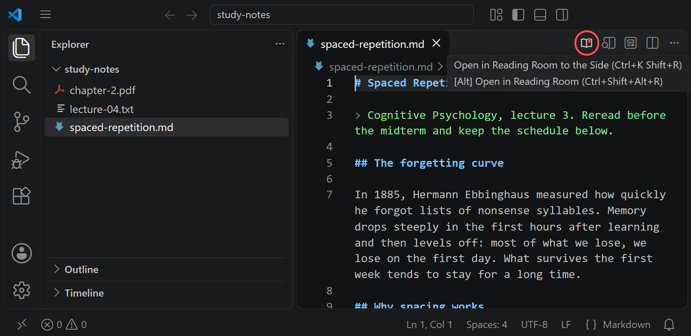
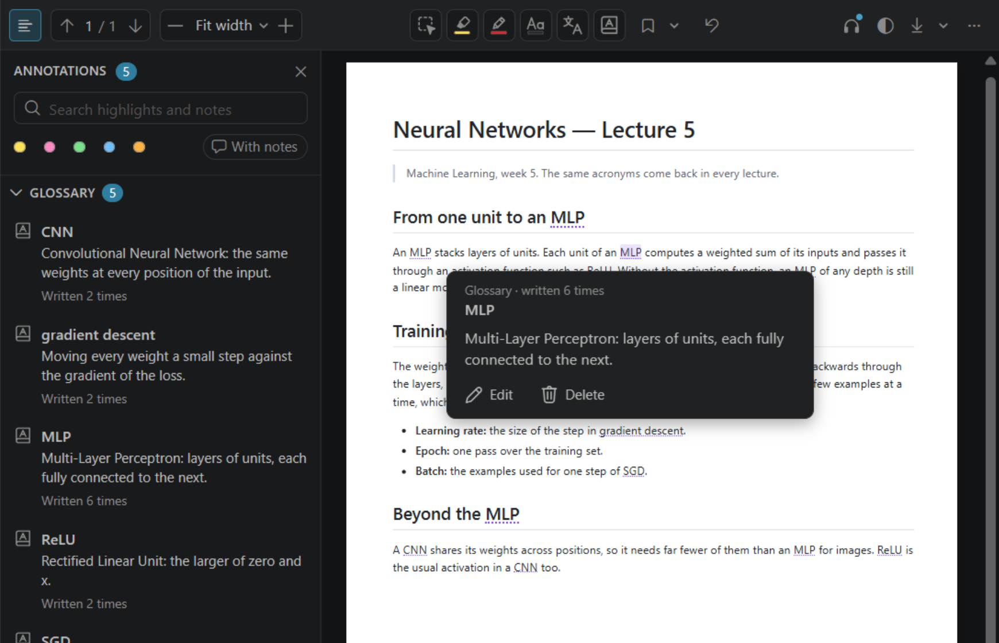
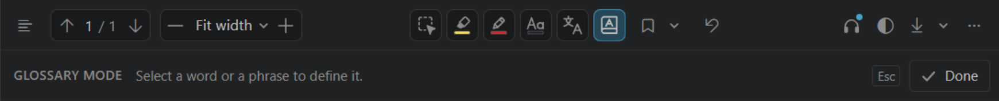
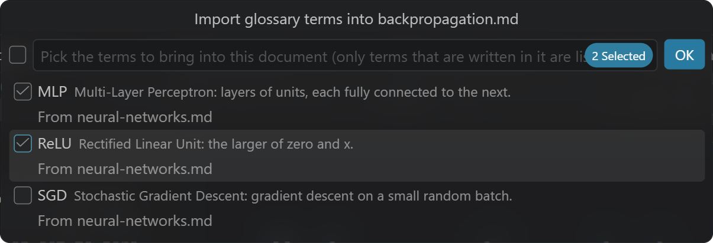
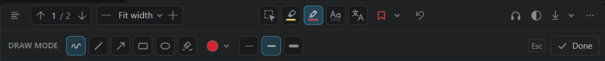
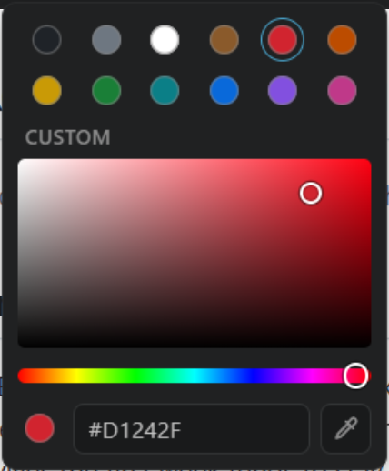
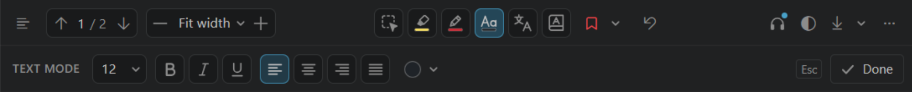
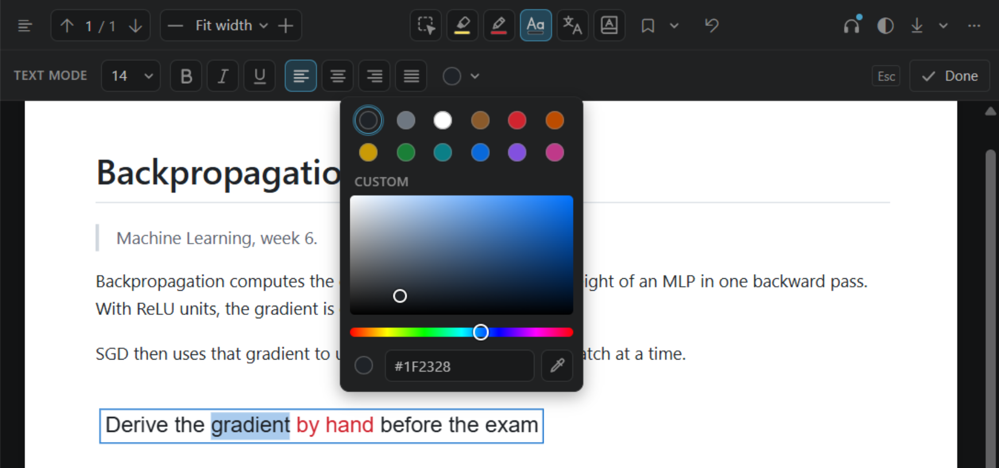
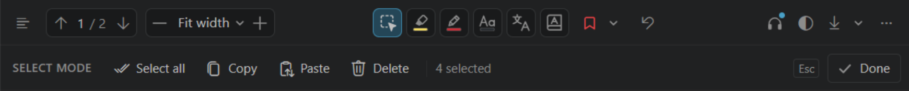
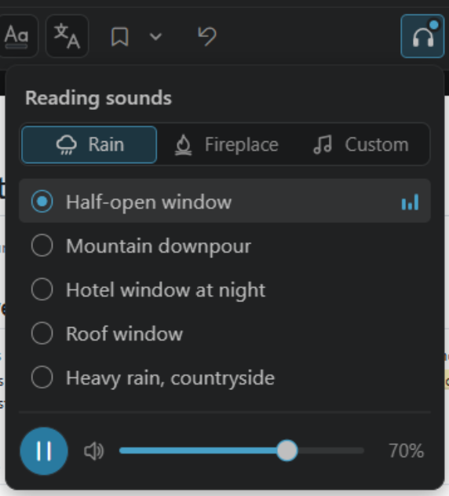

# Reading Room

**A quiet place to read and study inside VS Code.** Open PDF, Markdown and plain text files as pages, highlight what matters, write notes next to it, draw and type on the page, translate what you select without sending it anywhere, keep a glossary of the terms you meet, mark where you stopped, and read to the sound of rain, a crackling fireplace or your own recordings.

## What you can do

**Read**

- **PDF files** open as they are, including password-protected ones.
- **Markdown and `.txt` files** become print-quality pages: clickable links, an outline, syntax-highlighted code, math and diagrams. They are converted again when you save.
- **Long documents do not keep you waiting**: the first pages are there in a moment, and the rest follows while you read.
- Zoom freely (toolbar, `Ctrl`+wheel, pinch) and switch the pages to a **dark theme**.

**Study**

- **Highlight** text in five colors and write a **note** on any highlight.
- **Draw** anywhere on a page: pen strokes, lines, arrows, rectangles and ellipses, in any color and three widths.
- **Type** anywhere on a page: text boxes in any color and size, with bold, italic, underline and a color of its own on any part of the text.
- **Translate** what you select, between about sixty languages. The translating is done on your own computer: what you read is never sent anywhere.
- **Define terms**: write what a word or an acronym means once, and it is marked everywhere it is written. A click on it shows its meaning.
- **Select** several drawings and text boxes at once, with a click or a rectangle, to move, copy, paste or delete them together. Your highlights are left out, so they are never deleted by accident.
- **Take things back**: an undo button and `Ctrl+Z` that still work after you closed VS Code, and an eraser that rubs out part of a drawing.
- **Your annotations stay on their content** when the file changes. They follow the words (or the picture) they are on through your edits. If that content is deleted they are kept and listed, and they return when it does.
- A side list shows every highlight, note, drawing, text box and glossary term. Search it, filter it by color, click an entry to jump to it.

**Keep your place**

- Mark **where you stopped reading**. The document opens right there next time.

**Stay focused**

- **Reading sounds**: ten recordings of rain and fireplaces, or your own audio files, looping for as long as you read.

**Take it with you**

- **Download** a PDF with your highlights, notes, drawings and text boxes as standard PDF annotations. Acrobat, Edge, Chrome, Firefox and Preview all show them.

**Your files are left alone**

- Reading Room never changes your documents and never creates files in your folders. Everything you add is stored in VS Code's own storage for the extension, with a [backup](#your-data) in your user folder so that uninstalling does not delete it. The only other file it writes is a PDF you download, where you choose.

## Contents

- [Getting started](#getting-started)
- [The toolbar](#the-toolbar)
- [Highlights and notes](#highlights-and-notes)
- [Translating](#translating)
- [The glossary](#the-glossary)
- [Drawing](#drawing)
- [Text boxes](#text-boxes)
- [Selecting, copying and pasting](#selecting-copying-and-pasting)
- [Deleting and undoing](#deleting-and-undoing)
- [When the document changes](#when-the-document-changes)
- [Where you stopped reading](#where-you-stopped-reading)
- [Reading sounds](#reading-sounds)
- [Dark pages](#dark-pages)
- [Download](#download)
- [Keyboard shortcuts](#keyboard-shortcuts)
- [Settings](#settings)
- [Your data](#your-data)
- [What Markdown and text files look like](#what-markdown-and-text-files-look-like)
- [Troubleshooting](#troubleshooting)
- [Known limitations](#known-limitations)
- [Credits](#credits)

## Getting started

| To read | Do this | It opens |
| --- | --- | --- |
| A **PDF file** | Open it (Explorer, `Ctrl+P`, …) | In Reading Room, as the file's editor |
| A **Markdown or `.txt` file** | Click the **book button** in the editor title bar (top right) | To the side of the editor |
| | **Alt+click** the same button | In the current editor group, full width |
| | `Ctrl+K Shift+R`, or **Open in Reading Room to the Side** in the Command Palette | To the side |
| | `Ctrl+Shift+Alt+R`, or **Open in Reading Room** | In the current group |
| Any of them | Right-click the file in the Explorer → **Open in Reading Room to the Side** | To the side |

The **book button** is the first one at the top right of the editor, on the row of the tabs, whenever a Markdown or text file is open:

**Markdown and text files need a browser.** Their pages are made with Google Chrome, Microsoft Edge, Chromium or Brave, whichever is installed. If none is, Reading Room asks before downloading a small Chromium (about 126 MB) into its own storage. PDF files need nothing.

**Another PDF extension installed?** VS Code asks once which one should open PDF files. Choose **Keep Reading Room**. To change it later, right-click a PDF tab → **Reopen Editor With…** → **Configure default editor for '\*.pdf'…**.

Good to know:

- Each file has one Reading Room tab; opening it again brings that tab forward.
- A Markdown or text file is converted again when you **save** it, and you stay where you were. **Convert the document again** (in the ⋯ menu) also shows unsaved changes.
- A PDF file is reloaded when it changes on disk.
- **A long Markdown or text file** (about ninety pages or more) is shown part by part the first time: its first pages after a moment, with a line under the last one that says the rest is being converted, then the whole document. You can read, highlight and draw meanwhile, and you stay where you are when the rest arrives. Annotations and the reading marker that are further down appear with their pages.
- **A large PDF** (more than forty pages) shows its pages at once. Highlighting and the other tools are ready a few seconds later, when its text has been read.

## The toolbar

One row, in three groups: finding your place on the left, the tools in the middle, the room on the right.

| Control | What it does |
| --- | --- |
| ☰ | Show or hide the list of annotations: the reading position, highlights with their notes, drawings and text boxes |
| ↑ n / N ↓ | Previous and next page; type a number and press **Enter** to go to a page |
| − zoom ▾ + | Zoom out, choose a zoom (Fit width, Fit page, Actual size, 50 %–400 %), zoom in |
| Frame and pointer | **Select tool**: click a drawing or a text box, or drag a rectangle around several, then move, copy, paste or delete them together (see [Selecting, copying and pasting](#selecting-copying-and-pasting)) |
| Highlighter | **Highlight tool**: while it is on, every text selection becomes a highlight. The band under the icon shows the current color |
| Pencil | **Draw tool**: pen, lines, arrows, rectangles, ellipses and an eraser (see [Drawing](#drawing)). The band shows the current ink |
| Aa | **Text tool**: type anywhere on a page (see [Text boxes](#text-boxes)). The band shows the color new text gets |
| 文A | **Translate tool**: while it is on, every text selection is translated (see [Translating](#translating)) |
| Book with an A | **Glossary tool**: while it is on, select a word or a phrase to write what it means (see [The glossary](#the-glossary)) |
| 🔖 ▾ | **Reading marker**: click, then click the line where you stopped. The menu also has _Go to_ and _Remove_ |
| ↶ | **Undo** the last change. Its tooltip says what it will take back |
| 🎧 | **Reading sounds**: play rain, a fireplace or your own sounds |
| ◐ | **Dark pages**: switch the pages between light and dark |
| ⤓ ▾ | Download a PDF, with your annotations (the default) or without |
| ⋯ | **More**: **Full view** (Markdown, text: the pages take the source's editor group instead of standing next to it), **No bar when selecting text** (see [Highlights and notes](#highlights-and-notes)), **Import glossary terms…** (see [The glossary](#the-glossary)) and **Convert the document again** (PDF files: **Reload from disk**) |

**One tool at a time.** The six tools stand side by side, and turning one on turns the others off. The tool that is on is tinted and outlined, and a second row opens under the toolbar: its **tray**. The tray looks like the toolbar. It starts with the name of the mode (**DRAW MODE**, **TEXT MODE**, …), holds that tool's options right after it, and ends with **Done**. Done, a second click on the tool and **Esc** all turn the tool off. Placing the reading marker works the same way, with **Cancel**.

**In a narrow panel** the toolbar stays one row. What does not fit moves into ⋯, which always lists exactly what is missing from the bar: first the zoom and the download, then the reading marker and the sounds, and in a very narrow panel the page number, dark pages, the translate tool and the glossary tool.

## Highlights and notes

- **Highlight tool on**: select text, and it is highlighted in the current color. Its tray has the five colors: yellow, pink, green, blue, orange.
- **Highlight tool off**: select text and a small bar appears next to the selection. Pick a color, or use 💬 next to the colors to highlight and write a note right away. The buttons after the divider do something else with the selection: 🔖 marks that line as your reading position, **文A** [translates](#translating) it, and the book [defines](#the-glossary) it as a term.
  - **Do you follow the lines with the mouse as you read?** Turn on **No bar when selecting text** in the ⋯ menu, and selecting text opens nothing. It is off at first, and it is remembered for all files. While it is on, turn the highlight tool, the translate tool or the glossary tool on to highlight, translate or define what you select; a click on a highlight still opens its bar.
- **Click a highlight** to change its color, add or edit its note, copy its text or delete it. While its bar is open, **Delete** deletes it and **Enter** opens its note. A note shows under the buttons; click it to edit it.
- **Notes**: type, then press **Ctrl+Enter** or click **Save**. Clicking elsewhere also saves; **Esc** cancels. Highlights with a note have a darker underline and a 💬 badge in the right margin; hover to read the note.
- The **☰ list** shows your reading position at the top, then all highlights in document order with their notes, then your drawings, your text boxes and the glossary.
  - **Click an entry** to jump to it. The entry is selected, and what you can do with it opens under it: add or edit the note, copy, delete.
  - **Search** finds highlights by their text and their notes, and glossary terms by the term and its meaning. The five dots show only the highlights of those colors, and **With notes** only the ones that have a note.
  - Click a section's title to **collapse** it. That is remembered.

## Translating

Select some text and read it in another language. **The translating is done on your computer**: the text is never sent to a translation service, and once a language is on your computer it works without a connection.

- **With no tool on**: select text, then click **文A** in the bar that appears next to the selection.
- **With the translate tool on** (文A in the toolbar): every selection is translated as soon as you let go. Its tray has the two languages; **Done** or **Esc** turns it off.
- **A highlight**: click it, then **文A** in its popover.

The translation opens next to the text.

- **The two menus** at its top are the language of the text and the language to translate into. The first starts as **Detect language** and then says what was found, for example _Japanese (detected)_. If that is wrong, which can happen with a few words or with a language close to another, pick the right one: the text is translated again. The language you translate into is remembered, and starts as the language of VS Code.
- **Copy** copies the translation. **Save as note** highlights the text and keeps the translation as its note (for a highlight: adds it to its note), so it is in the list, in the search and in the PDF you download.
- Scrolling leaves the translation open. A click elsewhere or **Esc** closes it.

**Language packs.** Reading Room translates with the models Mozilla trains for Firefox's own page translation, one pack per language and direction.

- The first time you translate from or into a language, Reading Room asks before it downloads the pack: 11 to 38 MB, once, from Mozilla's storage into VS Code's storage for this extension. That download is the only time the translate tool uses the network.
- Every pack is to or from English. Between two other languages (Japanese to Portuguese) Reading Room translates by way of English, with two packs; the translation says so.
- **Reading Room: Manage Translation Languages…** lists the packs on your computer, removes one, and downloads the packs of a language ahead of time, for reading without a connection later.
- `readingRoom.translationDownload: never` forbids downloads: only the languages that are on the computer already can be translated.

**What to expect.** The translations are good for understanding a passage, and plainer than those of the large online services: a rare word, a name or a very long sentence can come out wrong. While a translation is being made, the translator takes about half a gigabyte of memory, and about one gigabyte between two languages other than English (two packs); it gives them back a minute after you last used it.

## The glossary

Keep the meaning of the words you meet. Define a term once, and every place where it is written in the document is marked with a dotted purple line. Click a marked term to read what it means.

Click the book with an A in the toolbar to turn the glossary tool on. Its tray opens:

- **With the glossary tool on**: select a word, an acronym or a short phrase, and a small form opens with the term in it. Write what it means, then press `Ctrl+Enter` or click **Save**. A click elsewhere saves too; **Esc** cancels.
- **With no tool on**: select the term, then click the book at the end of the bar that appears next to the selection.
- **Click a marked term** to read its meaning, with **Edit** and **Delete** under it. Selecting a term you already defined opens it for editing.
- **What is marked.** Whole words only: `MLP` is not marked inside `MLPs`. A term written in capitals only, like `MLP` or `IT`, is found exactly as written; any other term is found whatever its capitals, so `gradient descent` also marks `Gradient Descent`.
- **The ☰ list** has a **Glossary** section: every term with its meaning and how many times it is written. Click a row to go to the term, and again for the next place.
- **Each document has its own glossary**, because the same acronym can mean two things in two documents.
- **Import glossary terms…** in the ⋯ menu brings in terms you defined in other documents. It lists only the ones that are written in this document, with the document each comes from. Tick the ones you want. A term that two documents define differently is listed once for each meaning, and a term this document already defines is not listed: its own meaning stays.

  

- Defining, changing, deleting and importing terms can be undone with `Ctrl+Z`.
- The glossary is stored with your annotations and is in the [backup](#your-data), so it comes back when the extension is installed again. It follows a document you rename inside VS Code.

## Drawing

Circle a figure, underline a line, point at something with an arrow, scribble in the margin. Drawing works on any page: over text, pictures, tables and empty space, on light and dark pages, at any zoom, with mouse, pen and touch.

Click the pencil in the toolbar. Its tray opens, and every drag on a page draws:

| Tool | Key | Draws | With Shift |
| --- | --- | --- | --- |
| Pen | `P` | A smoothed line that follows the pointer. A click leaves a dot | |
| Line | `L` | A straight line | The angle snaps to 15° steps |
| Arrow | `A` | A line with an arrowhead at the end | The angle snaps to 15° steps |
| Rectangle | `R` | The outline of the box you drag | A square |
| Ellipse | `O` | An ellipse inside the box you drag | A circle |
| Eraser | `E` | Rubs out the part of a drawing it goes over, like an eraser on paper | |

- **Ink**: the colored dot opens the color picker. Pick one of twelve colors, one of your recent colors, or any color (drag in the square and along the rainbow, or type a hex code).
- **Width**: thin, medium or thick.
- **Eraser**: a ring follows the pointer and shows exactly what will be rubbed out, also while you drag. With the eraser picked, the three widths become its three **sizes** (small, medium, large), the ring grows with them, and the ink button rests: the eraser has no color. Drag across a line to cut it in two, along it to shorten it.
- **Stop drawing** with **Esc**, **Done** or the pencil. Esc while dragging cancels only that shape.

**Change a drawing** (with the draw tool off): click its line. It gets a dashed outline and a small bar to pick another ink or width, to choose what it follows, or to delete it. Drag a selected drawing to move it.

## Text boxes

Write a word in the margin, label an arrow, add a correction. Click **AA** in the toolbar. Its tray opens:

- **Click** on a page and type. The box grows as you type; **Enter** starts a new line.
- **Drag** across a page instead to choose the box's width first: the text wraps inside it.
- **Size and alignment** apply to the whole box.
- **Bold, italic, underline and the color** go where you want them: select part of the text and click **B**, _I_ or U (or press `Ctrl+B`, `Ctrl+I`, `Ctrl+U`), or pick a color. With nothing selected they apply to what you type next.

  

- **Esc**, `Ctrl+Enter` or a click elsewhere ends typing. **Esc** again, **Done** or **AA** turns the text tool off.

**Change a text box**: with the text tool on, click its text to type in it, or drag it to move it. With the tool off, click a box to select it: a small bar changes its color, size, alignment and style, edits it (**Enter** or a double click) or deletes it. A color picked for a selected box goes to all of its text. Drag a handle on its side to make it wider or narrower.

## Selecting, copying and pasting

Click the select tool in the toolbar (a dashed frame with a pointer) to turn it on. Its tray has the actions and says how many things are selected:

- **Click** a drawing or a text box to select it. **Drag** from anywhere else to open a rectangle: every drawing and text box it touches is selected.
- **Highlights are left out.** The select tool does not take them, by a click, a rectangle or **Select all**, so deleting what you selected never deletes a highlight with it. To select a highlight, click it with no tool on.
- **Ctrl+click** adds one more to the selection, or takes it out. **Shift+click** selects everything between the last one you clicked and this one, in any direction: to the left or the right, upwards or downwards. (Across pages, it follows the reading order.) Hold `Ctrl` or `Shift` while you drag a rectangle to add what it touches. `Ctrl+A`, or **Select all**, takes every drawing and text box.
- **Drag** one of the selected drawings or text boxes and they all move together. You do not have to aim at a line or a letter: anywhere inside the dashed box of a selected drawing will do. Each stays on its own page.
- **Delete** (the key or the button) deletes everything that is selected. One undo brings it all back.
- **Copy** (`Ctrl+C`), **cut** (`Ctrl+X`) and **paste** (`Ctrl+V`) work on drawings and text boxes. They are pasted on the page in view, at the place they had on their own page. On the page of the original, the copy lands a little down and to the right, so it does not cover it. What is pasted is selected, ready to be dragged where it belongs. Highlights belong to their text, so they cannot be pasted: copying them copies their text.
- **Esc** lets go of the selection. **Esc** again, **Done** or the pointer turns the tool off.

**With no tool on**, the same works on what you click, and this is where highlights can be selected. Click a drawing, a text box or a highlight to select it, `Ctrl+click` others to add them (a highlight joins only when you click it yourself; `Shift+click` takes the drawings and text boxes in between, not the highlights), drag them by their dashed box, then use `Delete`, `Ctrl+C`, `Ctrl+X` and `Ctrl+V`. The bar of a drawing and of a text box has a **Copy** button too.

## Deleting and undoing

- **Undo**: the ↶ button in the toolbar, or `Ctrl+Z`, takes back the last change to your highlights, notes, drawings, text boxes, glossary terms and reading marker. `Ctrl+Y` or `Ctrl+Shift+Z` redoes it. While you type in a note or a text box, undo takes back the typing instead.
- **Undo lasts.** What you did is kept with your annotations, so you can still take it back after you closed the tab or VS Code, days later. Each document keeps its last 500 changes.
- **Delete** or **Backspace** deletes whatever is selected: one thing you clicked, or everything the select tool took.
- **Eraser** (in the draw tool's tray): rubs out only the part of a drawing under its ring. It leaves highlights and text boxes alone.
- Deleting everything of one kind: the 🗑 next to **Drawings** or **Text boxes** in the ☰ list, or the commands **Delete All Highlights / Drawings / Text Boxes for This File**. They ask first, and undo brings everything back.

## When the document changes

Markdown and text files change while you read them: you edit them, a formatter rewraps them, `git checkout` swaps them. PDF files get replaced by new versions. Everything you added stays on its content:

| What changed | What happens |
| --- | --- |
| Text added or removed elsewhere, lines rewrapped, another page size | Everything stays on the same words, wherever they are now |
| Bold, links, heading levels and other formatting | Nothing changes |
| Words changed inside a highlight | It stays on the passage. The list marks it **Changed** and shows the old text struck through above the new one; **Keep as it is now** keeps it on the text as it is now |
| The start or the end of a highlight deleted | It shrinks to what is left |
| All of its text deleted | It becomes **orphaned**: kept with its note and listed with the reason, not shown on the page |
| Its text replaced by other text | Orphaned, with a button to attach it to the text that took its place |
| The passage moved elsewhere | Everything moves with it |
| The file emptied, or replaced by another text | Everything is orphaned, nothing is deleted, and a banner says so |
| The text comes back (undo, `git checkout`, a restored file) | Everything returns to where it was, by itself |

- **Nothing is ever deleted automatically.** Orphaned annotations stay in the list until you delete them.
- **Drawings and text boxes** are attached to what they cover: the words under them, the line beside them, the picture they are on, or the page. The small bar of a selected drawing has a menu that says what it follows and lets you choose.
- **The reading marker** follows its line. When the line is deleted, the marker stands where the line was, with "You stopped about here".
- A message at the bottom says what a change did, only when something changed.

## Where you stopped reading

The reading marker is a red line with a bookmark tab. There is one per document.

- **Place it**: click 🔖 in the toolbar, then click a line. Or select some text and click 🔖 in the selection bar.
- **Next time you open the document**, Reading Room scrolls straight to the marker.
- **Move or remove it**: click its tab, use the 🔖 ▾ menu, or select it in the ☰ list.
- When a restored tab is somewhere else in the document, a message offers to **Continue** where you stopped.

## Reading sounds

Click 🎧 in the toolbar:

- **Pick a kind of sound**: **Rain**, **Fireplace** or **Custom** (your own). It starts with a short fade-in.
- In a narrow panel the 🎧 is in the ⋯ menu: **Reading sounds…**.
- **Pick the recording** in the list below. Each kind remembers its choice.
- **Pause or play** with the round button and set the **volume** with the slider.
- The panel closes when you click elsewhere. The sound keeps playing until you pause it, also when you switch to another tab.

The sound never ends and never clicks, and all recordings are equally loud. One sound plays at a time, however many documents are open. The command **Reading Room: Play/Pause Reading Sounds** works from anywhere, and you can give it a shortcut.

**Your own sounds**: under **Custom**, **Add sound files…** adds MP3, Ogg Vorbis, WAV or FLAC files (up to 150 MB each). They loop like the built-in ones and play as loud. Reading Room keeps its own copy, so you can move or delete the original. The sound that is picked has two buttons, to rename it and to remove it.

## Dark pages

The **◐** button in the toolbar switches all pages to a dark theme, and back. (In a very narrow panel it is **Dark pages** in the ⋯ menu.) Markdown and text files are converted again with dark colors. PDF files are inverted, keeping their hues; pictures keep their real colors. Downloads always use normal light pages.

## Download

**Download** opens a save dialog in your Downloads folder.

- **With annotations** (the default): highlights become PDF highlight annotations with their notes as comments, drawings become ink, line, square and circle annotations, and text boxes become free text annotations. Other PDF readers show them, and the ones that edit annotations can change them.
- **Without annotations** (in the ▾ menu) saves the plain PDF.
- Reading Room never overwrites the document you are viewing.
- A password-protected PDF is saved **without** its password when it is downloaded with annotations; the confirmation says so.

## Keyboard shortcuts

| Shortcut | What it does | When |
| --- | --- | --- |
| `Ctrl+K Shift+R` | Open in Reading Room to the Side | A Markdown or `.txt` editor is focused |
| `Ctrl+Shift+Alt+R` | Open in Reading Room (current group) | A Markdown or `.txt` editor is focused |
| `Ctrl+Z` | Undo | Reading Room is focused |
| `Ctrl+Y`, `Ctrl+Shift+Z` | Redo | Reading Room is focused |
| `Delete`, `Backspace` | Delete what is selected | Something is selected |
| `Ctrl+C`, `Ctrl+X` | Copy or cut what is selected (highlights: their text) | Something is selected |
| `Ctrl+V` | Paste copied drawings and text boxes on the page in view | Reading Room is focused |
| `Ctrl+click`, `Shift+click` | Add to the selection or take out of it; select a range | Over an annotation |
| `Ctrl+A` | Select every drawing and text box | The select tool is on |
| `Enter` | Edit what is selected: type in the text box, write the highlight's note | A text box or a highlight is selected |
| `Ctrl+Enter` | Save the note or the term; stop typing in a text box | Writing a note, defining a term or typing in a text box |
| `Esc` | Back out of one thing at a time: what is in progress, an open menu or popup, the selected entry of the list, what the select tool selected, the tool that is on | Reading Room is focused |
| `P`, `L`, `A`, `R`, `O`, `E` | Pen, Line, Arrow, Rectangle, Ellipse, Eraser | The draw tool is on |
| `↓`, `Enter`, `Space` | Open a menu; `↑` `↓` `Home` `End` move in it, typing jumps to an item | A button with a ▾ (or ⋯) is focused |
| `Shift` (held) | Lines and arrows in 15° steps; squares and circles | Drawing a shape |
| `Ctrl+B`, `Ctrl+I`, `Ctrl+U` | Bold, italic, underline | Typing in a text box |
| `Ctrl+=`, `Ctrl+Numpad+` | Zoom in | Reading Room is focused |
| `Ctrl+-`, `Ctrl+Numpad-` | Zoom out | Reading Room is focused |
| `Ctrl+Wheel`, pinch | Zoom around the pointer | Pointer over the pages |

On macOS, use `Cmd` instead of `Ctrl`.

All commands are in the Command Palette: type **Reading Room**. Commands without a shortcut (the modes, the reading marker, the sounds, downloads) can be given one in **Preferences: Open Keyboard Shortcuts**.

## Settings

| Setting | Default | Description |
| --- | --- | --- |
| `readingRoom.defaultOpenMode` | `side` | What a plain click on the title-bar button does: `side` or `full` (Alt+click does the other) |
| `readingRoom.pageSize` | `A4` | `A4` or `Letter`, for Markdown and text files |
| `readingRoom.pageNumbers` | `true` | Print "n / N" at the bottom of each page |
| `readingRoom.renderOnSave` | `true` | Convert again when a Markdown or text file is saved |
| `readingRoom.allowRemoteImages` | `true` | Download `http(s)` images and show them on the pages |
| `readingRoom.cacheDays` | `7` | Days the pages of a Markdown or text file are kept after it was last opened, so it reopens instantly. `0` turns the cache off |
| `readingRoom.textSnapshots` | `true` | Keep a compressed copy of a document's text, so annotations can follow it exactly through changes. `false` deletes the copies; annotations are then found by searching for their text |
| `readingRoom.backup.enabled` | `true` | Keep a second copy of your annotations outside VS Code's storage, so they come back when the extension is installed again (see [Your data](#your-data)). `false` stops the copying and leaves the folder as it is |
| `readingRoom.chromiumPath` | _(empty)_ | Path to a Chrome, Edge or Chromium executable; empty means detect one |
| `readingRoom.chromiumDownload` | `ask` | `ask`: offer to download Chromium when no browser is found; `never`: show an error instead |
| `readingRoom.translationDownload` | `ask` | `ask`: offer to download a language pack when a translation needs one; `never`: translate only with the packs that are on this computer |

The settings are the same in every workspace: workspace settings cannot change them.

## Your data

Highlights, notes, drawings, text boxes, glossaries, reading positions and your own sounds live in VS Code's storage for this extension, never in your folders. **Reading Room: Reveal Annotation Data Folder** opens it.

- **Backup**: VS Code deletes an extension's storage when the extension is uninstalled. So Reading Room keeps a second copy of your annotations, of your glossaries and of the undo history, in a folder of its own outside VS Code. When it is installed again and finds no annotations, it brings them back from there and tells you. **Reading Room: Reveal Backup Folder** opens the folder:

  | OS | Backup folder |
  | --- | --- |
  | Windows | `%APPDATA%\Reading Room\backup` |
  | macOS | `~/Library/Application Support/Reading Room/backup` |
  | Linux | `~/.local/share/reading-room/backup` |
  - The copy follows every change, deletions too. It is a second copy, not a history of older versions.
  - It is on this computer only, and shared by all your VS Code profiles: a profile without annotations starts with the ones in the backup.
  - Your own sounds are not in it. After a new install, add them again.
  - To remove your annotations for good after uninstalling, delete that folder. The setting `readingRoom.backup.enabled` turns the backup off.
- **Another computer**: copy the `highlights` folder (and `sounds` for your own sounds) into the same place there while VS Code is closed.
- **Renames**: when you rename or move a document inside VS Code, its annotations and its glossary follow it. If you renamed it elsewhere, open the new file and run **Reading Room: Reattach Annotations from Another File…**, which copies both.
- **Start over for one file**: the **Delete All …** commands (undo brings everything back).
- Annotations are kept per VS Code profile. Uninstalling the extension deletes them from VS Code's storage; the backup is what brings them back.
- **Language packs** of the translate tool are in the same storage, in `translation`. They are not in the backup: after a new install they are downloaded again when you need them. **Reading Room: Manage Translation Languages…** removes them.
- For files you annotated, a compressed copy of their text is kept there too (see `readingRoom.textSnapshots`), and the pages of Markdown and text files are cached for a few days (**Reading Room: Clear Cached Pages** deletes them).

## What Markdown and text files look like

**Markdown**: headings (with an outline), tables, images (local, remote and SVG, all embedded), syntax-highlighted code, nested and task lists, blockquotes and GitHub alerts, footnotes, inline HTML, emoji shortcodes, **KaTeX** math and **Mermaid** diagrams. Links work: web links open your browser, `#heading` links jump within the document, and links to other files open them in VS Code. Images, diagrams and table rows are never split across pages.

**Plain text**: exactly as written, in a monospace font, with long lines wrapped. Web and mail addresses become clickable links.

## Troubleshooting

- **PDF files open in another viewer**: right-click the tab → **Reopen Editor With…** → **Reading Room**. **Configure default editor for '\*.pdf'…** in the same list makes it permanent.
- **"needs Chrome, Edge or Chromium"** (Markdown and text only): install one of them, choose a browser when asked, or let Reading Room download Chromium.
- **The browser cannot start** (some company policies block it): choose **Download Chromium** in the message, or set `readingRoom.chromiumPath` to another browser.
- **An image is missing**: the yellow banner and **Reading Room: Show Log** list every image that could not be loaded.
- **The pages look outdated**: choose **Convert the document again** in the ⋯ menu, or run **Reading Room: Clear Cached Pages**.
- **"Click anywhere in this viewer to start the sound"**: VS Code lets a tab play sound only after you have clicked or typed in it. One click and it plays.
- **"… can't be played in VS Code"**: the file's audio is in a format VS Code lacks (usually Opus or AAC). Convert it to MP3, Ogg Vorbis, WAV or FLAC.
- **The translation is in the wrong language, or says the text is in your language already**: the language of the text was told wrong. Pick it in the first menu of the translation.
- **Downloading a language pack fails**: check the connection, and VS Code's proxy settings (`http.proxy`) behind a proxy, then choose **Try again** in the translation.
- Anything else: run **Reading Room: Show Log**.

## Known limitations

- PDFs without a text layer (scanned pages) cannot be highlighted. Drawing, text boxes and the reading marker still work there.
- Annotations already inside a PDF are shown but cannot be edited.
- A drawing or text box cannot span two pages.
- Two identical passages cannot always be told apart: when an annotated paragraph is duplicated outside VS Code, its annotations may end up on the copy.
- Drawings on a formula or a diagram follow the nearest line of text or the diagram as a whole, not single symbols.
- A text box has one font, size and alignment. In downloads, characters outside Western European languages, and emoji, appear as "?" in text boxes (the download's message says how many).
- What the eraser leaves of a rectangle or an ellipse is a plain stroke.
- Translating needs text that can be selected: scanned pages cannot be translated. Formulas, tables and text in pictures are not translated as such.
- A translation is made sentence by sentence: the translator does not know the rest of the document, so the same term can be translated in two ways on two pages. At most 20,000 characters are translated at once.
- Glossary terms are found as whole words, exactly as they are spelled: a plural or another form of a term is not marked, nor is a term that a line break cuts with a hyphen. Scanned pages have no text to mark.
- The glossary is not written into the PDF you download.
- While the first part of a long document is on screen, the rest is not there yet: the page count grows, and **Go to** the reading marker waits for its page.
- Reading sounds play only while a Reading Room tab is open.
- Renames done outside VS Code are not detected (use _Reattach Annotations_).

## Credits

The translate tool is built on the work of the [Bergamot project](https://browser.mt/) and of Mozilla: the translation engine ([bergamot-translator](https://github.com/browsermt/bergamot-translator), Mozilla Public License 2.0) and the [language models Mozilla trains for Firefox](https://github.com/mozilla/translations). The language of a text is told with [franc](https://github.com/wooorm/franc) and [tinyld](https://github.com/komodojp/tinyld) (both MIT).

The built-in reading sounds are loops cut from these recordings on [Freesound](https://freesound.org/), which their authors dedicated to the public domain ([Creative Commons 0](https://creativecommons.org/publicdomain/zero/1.0/)). Thank you for recording and sharing them.

| Sound | Recording | Recorded by |
| --- | --- | --- |
| Rain: Half-open window | [Rain from Half Open Window 1.aif](https://freesound.org/people/RutgerMuller/sounds/158690/) | RutgerMuller |
| Rain: Mountain downpour | [Rain_in_Albanian_Mountains_White_Noise](https://freesound.org/people/SignatureSoundsOrg/sounds/872734/) | SignatureSoundsOrg |
| Rain: Hotel window at night | [Dharamshala Rain](https://freesound.org/people/AugustSandberg/sounds/508527/) | AugustSandberg |
| Rain: Roof window | [Rain on the House Roof Window #001](https://freesound.org/people/bassimat/sounds/833924/) | bassimat |
| Rain: Heavy rain, countryside | [Rain heavy 1 (rural)](https://freesound.org/people/jmbphilmes/sounds/200270/) | jmbphilmes |
| Fireplace: Home fireplace | [Fireplace.wav](https://freesound.org/people/inchadney/sounds/132534/) | inchadney |
| Fireplace: Close fireplace | [Fireplace for Six Minutes (Stereo)](https://freesound.org/people/petebuchwald/sounds/496130/) | petebuchwald |
| Fireplace: Living room fireplace | [Aachen_Burning Fireplace Crackling Fire Sounds.wav](https://freesound.org/people/visionear/sounds/501417/) | visionear |
| Fireplace: Log cabin (binaural) | [(binaural) fire crackling](https://freesound.org/people/yfjesse/sounds/734248/) | yfjesse |
| Fireplace: Small fire, wet log | [fireplace-jim.aif](https://freesound.org/people/hovercraft/sounds/66412/) | hovercraft |

Reading Room is built on [PDF.js](https://mozilla.github.io/pdf.js/), [markdown-it](https://github.com/markdown-it/markdown-it), [Shiki](https://shiki.style/), [KaTeX](https://katex.org/), [Mermaid](https://mermaid.js.org/) and [pdf-lib](https://github.com/cantoo-scribe/pdf-lib). Icons are VS Code's [Codicons](https://github.com/microsoft/vscode-codicons), plus a few drawn for it.

Building it from source, how it works inside and the format of the stored files are described in [docs/DEVELOPMENT.md](docs/DEVELOPMENT.md).
