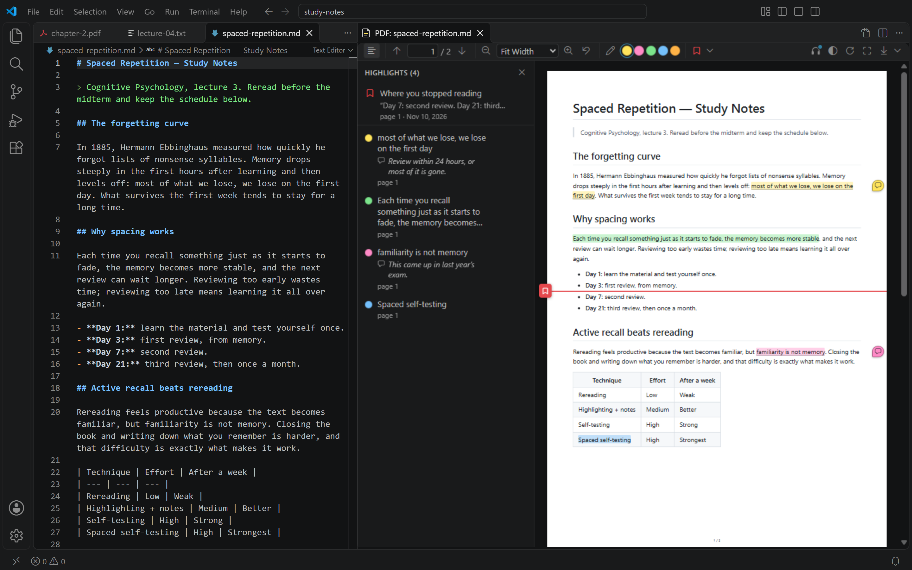
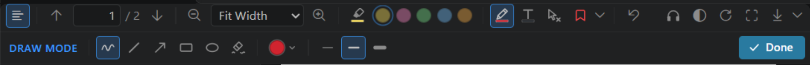
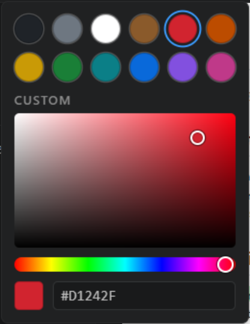
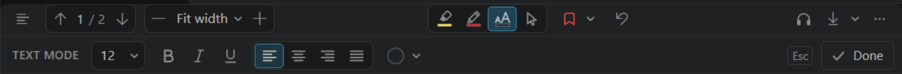
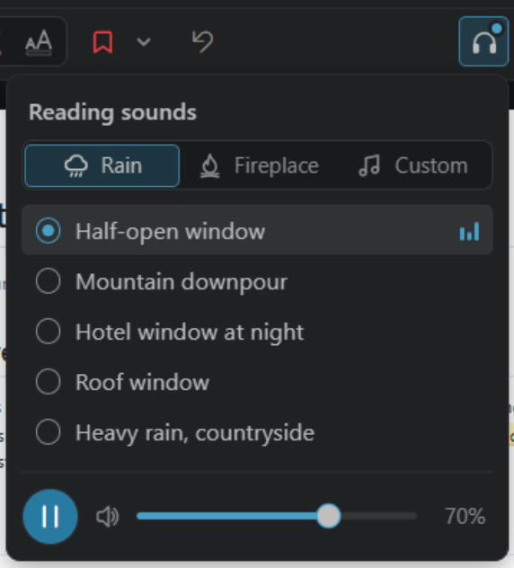

# Document Viewer & Highlighter

**A quiet reading room inside VS Code.** Open Markdown, plain text and PDF files as real PDFs, highlight what matters, write notes next to it, draw and type on the page, mark where you stopped, and read to the sound of rain, a crackling fireplace or your own recordings.



## Features

**Read anything as a PDF**
- **PDF files** open directly in the viewer, exactly as they are, including password-protected ones.
- **Markdown and `.txt` files** become real, print-quality PDFs (Chromium print-to-PDF): clickable links, an outline, syntax-highlighted code, math and diagrams. Converted PDFs are cached, so reopening an unchanged file is instant.
- Zoom freely (toolbar, `Ctrl`+wheel, pinch) and switch the pages to a **dark theme**.

**Highlight and annotate**
- Highlight text in **five colors** and write a **note** on any highlight.
- **Draw** anywhere on a page: pen strokes, lines, arrows, rectangles and ellipses, in any color and three widths.
- **Type** anywhere on a page: text boxes in any color and size, aligned left, centered, right or justified, with bold, italic and underline on all of the text or on any part of it.
- **Erase** any of it: one eraser deletes highlights, drawings and text boxes with a click or a drag; another rubs out just the part of a drawing it goes over.
- **Everything stays on its content when the file changes**: highlights, notes, the reading position, drawings and text boxes follow the text (or the picture) they are on through your edits. If their content is deleted they are kept and listed, and they come back when it does.
- A side list shows every highlight, note, drawing and text box; click one to jump to it.
- The same keys for everything: **Delete** deletes what is selected, **Enter** edits it, and `Ctrl+Z` / `Ctrl+Y` **undo and redo** all of it.

**Keep your place**
- Mark **where you stopped reading**. The document opens right there next time.

**Stay focused**
- **Reading sounds**: ten recordings of rain and fireplaces, or your own audio files, looping seamlessly for as long as you read, with play/pause and volume in a small panel that disappears when you click away.

**Take it with you**
- **Download** the PDF with your highlights, notes, drawings and text boxes as standard PDF annotations, which Acrobat, Edge, Chrome, Firefox and Preview all show.

**Leaves your files alone**
- Highlights, notes, drawings, text boxes and reading positions are stored per file **outside your workspace**, and survive restarts, edits and renames.
- **The extension never writes to your documents and never creates files in your workspace.** The only file it writes outside its own storage folder is a PDF you download, where you choose.

## Contents

- [Install](#install)
- [Requirements](#requirements)
- [Using it](#using-it): opening documents, highlights, notes, [drawing](#drawing), [text boxes](#text-boxes), [erasing](#erasing), [what happens when the document changes](#when-the-document-changes), the reading marker, [reading sounds](#reading-sounds), undo, download
- [Keyboard shortcuts](#keyboard-shortcuts)
- [Settings](#settings)
- [Where your data is stored (backup and reset)](#where-your-data-is-stored-backup-and-reset)
- [What gets converted](#what-gets-converted)
- [Troubleshooting](#troubleshooting)
- [Development](#development)
- [Known limitations](#known-limitations)
- [Credits](#credits)

## Install

The extension is installed from a `.vsix` file that you build yourself; it is not on the Marketplace. You need Node.js 22 or newer. From the project folder:

1. Install the dependencies:

   ```bash
   npm install
   ```

2. Build the package:

   ```bash
   npm run package
   ```

3. Install it:

   ```bash
   code --install-extension markdown-pdf-viewer-0.8.0.vsix --force
   ```

Then reload VS Code (**Developer: Reload Window**) or open a new window. Installing a newer `.vsix` replaces the previous version and keeps your highlights. The extension ID is still `local.markdown-pdf-viewer`, from the days it only handled Markdown.

To uninstall, run `code --uninstall-extension local.markdown-pdf-viewer`. Uninstalling keeps your stored highlights (see [Where your data is stored](#where-your-data-is-stored-backup-and-reset)).

## Requirements

- VS Code 1.110 or newer.
- For **Markdown and text files only**: a Chromium-based browser to produce the PDF. PDF files need nothing else. The extension uses, in this order:
  1. the browser set in **`markdownPdfViewer.chromiumPath`**,
  2. an installed **Google Chrome**, **Microsoft Edge**, **Chromium** or **Brave**,
  3. a Chromium previously downloaded by the extension.

  If none is found, the extension asks before downloading *chrome-headless-shell* (about 126 MB) into VS Code's global storage folder (never into your workspace). Set `markdownPdfViewer.chromiumDownload` to `never` to forbid that.

The browser runs headless, with JavaScript disabled for your document and no network access except remote images (which you can turn off). Its temporary profile lives in the OS temp folder and is deleted when the browser closes. The browser itself closes after two idle minutes.

## Using it

### Open a document

| What | How | Opens |
|---|---|---|
| **PDF file** | Open it (Explorer, `Ctrl+P`, …) | In the viewer, as the file's editor |
| **Markdown or `.txt` file** | The **PDF button** in the editor title bar (top right) | To the side of the editor |
| | **Alt+click** on the same button | In the current editor group, full width |
| | **Document Viewer: Open PDF Preview to the Side** (`Ctrl+K Shift+P`) | To the side |
| | **Document Viewer: Open PDF Preview** (`Ctrl+Shift+Alt+P`) | In the current group |
| Any of them | Explorer context menu → **Open PDF Preview to the Side** | To the side |

**Another PDF extension installed?** VS Code then asks once, in a notification ("There are multiple default editors available for the resource"). Choose **Keep Document Viewer**. To change it later, right-click a PDF tab → **Reopen Editor With…** → **Configure default editor for '\*.pdf'…**.

For Markdown and text files:
- The setting `markdownPdfViewer.defaultOpenMode` swaps what a plain click and Alt+click do.
- Each file has at most one viewer; opening it again focuses the existing one.
- The PDF is converted again when you **save** the file, keeping your reading position, or when you press **Refresh**. Refresh includes unsaved changes.
- A PDF file is reloaded when it changes on disk.

### The toolbar

| Control | What it does |
|---|---|
| ☰ | Show or hide the list of annotations: the reading position, highlights with their notes, drawings and text boxes |
| ↑ ↓, page box | Previous/next page, go to a page |
| − / zoom list / + / ↺ | Zoom out, choose a zoom (Fit Width, Fit Page, Actual Size, 50 %–400 %), zoom in, reset to Fit Width |
| 🖍 (highlighter) | **Highlight tool**: while it is on, every text selection becomes a highlight. The band under the marker shows the current color |
| ● ● ● ● ● | Highlight color: yellow (default), pink, green, blue, orange. The last color you used is remembered |
| ✏️ (pencil) | **Draw**: turns drawing on, with a second row of drawing tools (see [Drawing](#drawing)). The band under the pencil shows the current ink |
| T | **Text**: turns adding text on, with a second row of text tools (see [Text boxes](#text-boxes)). The band under the T shows the color new text gets |
| Eraser | **Erase**: while it is on, a click deletes the highlight, drawing or text box under the pointer, and a drag deletes everything it goes over (see [Erasing](#erasing)) |
| 🔖 ▾ | **Reading marker**: click, then click the line where you stopped reading. The menu also has *Go to* and *Remove* |
| 🎧 | **Reading sounds**: opens a small panel to play rain, a fireplace or your own sounds, pick the recording, pause and set the volume. A dot on the button means a sound is playing |
| ◐ | **Light/dark pages** (remembered for all files). Downloads always use normal light pages |
| ⟳ | Convert again (Markdown/text) or reload from disk (PDF) |
| ⤢ | **Full view** (Markdown/text): move the PDF between "next to the source" and "in the source's editor group". Works with **View: Toggle Maximized Editor Group** and **Zen Mode** |
| ⤓ ▾ | Download the PDF, with highlights, notes, drawings and text boxes (default) or without any annotations |

The highlight tool, drawing, adding text, erasing and placing the reading marker exclude each other: turning one on turns the others off.

Zoom also works with **Ctrl + mouse wheel** and **trackpad pinch**. Pages are re-rendered sharply at every zoom level and when the VS Code window zoom or the monitor's scale changes.

### Highlighting

- **Highlight tool on**: select text; it is highlighted in the current color.
- **Highlight tool off**: select text and a small bar appears next to the selection. Pick a color, or use 💬 to highlight and write a note right away, or 🔖 to mark that line as your reading position. You can also select text and click a color in the toolbar.
- **Click a highlight** to change its color, add or edit its note, copy its text, or delete it. While its small bar is open the highlight is the selected one (it shows darker): **Delete** deletes it and **Enter** opens its note.
- The **☰ list** (*Annotations*) shows your reading position at the top, then all highlights in document order with their notes and page, then your drawings and text boxes. Click one to jump to it.

What happens to highlights when the file changes is described in [When the document changes](#when-the-document-changes).

Highlights are attached to the *text*, not to a position on the page. Each one stores the highlighted words plus some text before and after (a W3C Web Annotation *TextQuoteSelector*), with the page and position as hints. Every time the PDF changes, the extension finds each highlight again, so highlights follow the text when you edit a Markdown or text file.

### Notes

Every highlight can carry a note, for example why you highlighted it.

- **Add or edit**: click the highlight, then 💬 (or click the note text). Type, then press **Ctrl+Enter** or click **Save**. Clicking anywhere else also saves; **Esc** cancels. An empty note removes it.
- **See them**: highlights with a note have a darker underline and a 💬 badge in the right margin. Hover over either to read the note, or click the badge to edit it. The ☰ list shows every note under its highlight.
- **Download**: each note becomes the comment of its PDF annotation, so other PDF readers show it in their comment popups and comment lists.

### Drawing

Circle a figure, underline a line, point at something with an arrow, scribble in the margin. Drawing works on any page of Markdown, text and PDF files (scanned and password-protected ones too): over text, pictures, tables, empty space and your other annotations, on light and dark pages, at any zoom.

Click ✏️ **Draw** in the toolbar (or run **Document Viewer: Toggle Drawing**). A second row of tools appears under the toolbar, and every drag on a page draws:



| Tool | Key | Draws | With Shift |
|---|---|---|---|
| Pen | `P` | A smoothed line that follows the pointer. A click leaves a dot | |
| Line | `L` | A straight line from where you press to where you let go | The angle snaps to 15° steps |
| Arrow | `A` | A line with an open arrowhead at the end | The angle snaps to 15° steps |
| Rectangle | `R` | The outline of the box you drag | A square |
| Ellipse | `O` | The outline of an ellipse inside the box you drag | A circle |
| Eraser | `E` | Rubs out the part of a drawing it goes over, like an eraser on paper: drag across a line to cut it in two, along it to shorten it. The round cursor is its size. What is left keeps its shape | |

- **Ink**: the colored dot opens the **color picker**. Pick one of twelve colors (white is one of them: it covers what is under it on a white page, and shows on dark pictures), one of your recent colors, or any color: drag in the square (saturation and brightness) and along the rainbow (hue), or type its hex code. The arrow keys move through the colors, and **Esc** closes the picker. On dark pages a dark ink is drawn lighter so it stays visible (black shows up light); downloads always use the color you picked.
- **Width**: thin, medium or thick. The last tool, ink and width are remembered for all files.
- **Stop drawing** with **Esc**, **Done** or ✏️. Esc while dragging cancels only that shape.


- While drawing, links, text selection and the highlight and note popups take a break; the mouse wheel still scrolls, and `Ctrl`+wheel and the zoom keys still zoom. Mouse, pen and touch all work.

**Change a drawing** (with drawing off): click its line. It gets a dashed outline and a small bar to pick another **ink** (the same color picker; the drawing shows each color as you drag) or **width**, or to **delete** it (**Delete** and **Backspace** do too; **Esc** deselects). **Drag** a selected drawing to move it on its page; to resize one, draw it again. Clicking *inside* a rectangle or an ellipse does not select it, so the text inside stays selectable. Where drawings overlap, a click picks the smallest; a drawing over a highlight wins the click, because it is on top.

**Erase part of a drawing** with the eraser of the drawing bar: what it goes over is gone, and the rest stays as it was, corners and curves included. The rest of a shape becomes plain strokes (the two halves of a cut rectangle are two drawings, listed as *Freehand*). The drawing eraser does not touch text boxes or highlights. To delete whole things, use the [eraser of the toolbar](#erasing), or select a drawing and press **Delete**.

The ☰ list has a **Drawings** section with a small picture of each drawing: click one to go to it, or 🗑 to delete it. The section's own 🗑 (or **Document Viewer: Delete All Drawings for This File**) deletes all drawings of the file, after asking. Everything can be undone with `Ctrl+Z`; one eraser drag is one undo step.

Drawings stay where you drew them on their page. When a Markdown or text file is converted again they keep their place on the page; unlike highlights, they do not follow the text yet. A drawing on a page the document no longer has is kept and listed, but not shown.

### Text boxes

Write a word in the margin, label an arrow, add a correction. Click **T** in the toolbar (or run **Document Viewer: Toggle Adding Text**). A row of text tools appears under the toolbar:



- **Click** on a page and type. The box grows as you type and wraps at the right edge of the page; **Enter** starts a new line.
- **Drag** across a page instead to choose the box's width first: the text wraps inside it. Justified text needs a box like that.
- **Size, alignment and color** apply to the whole box: set them before you click, or while you type.
- **Bold, italic and underline** go where you want them. While typing, select part of the text (with the mouse, or Shift and the arrow keys) and click **B**, *I* or U in the bar, or press **Ctrl+B**, **Ctrl+I** or **Ctrl+U**: only that part changes. With nothing selected they switch on or off for what you type next. The three buttons show the style at the caret, or of the selection.
- New boxes get the last size, alignment and color you picked, and the bold, italic and underline you last set for typing.
- Pasted text comes in as plain text, in the style you are typing in. While typing, **Ctrl+Z** and **Ctrl+Y** undo and redo the typing.
- **Esc**, **Ctrl+Enter** or a click anywhere else ends typing. A box whose text you erase is deleted (and **Ctrl+Z** brings it back).
- **Stop adding text** with **Esc** (when you are not typing), **Done** or **T**.

**Change a text box**: in text mode, click its text to type in it (the caret goes where you click), or drag it to move it. With text mode off, click a box to select it: a small bar changes its color, size and alignment, makes all of its text bold, italic or underlined (or none of it), edits it (✎, **Enter** or a double click) or deletes it (🗑, **Delete** or **Backspace**); drag it to move it. A selected box has a handle on each side: drag one to make the box wider or narrower.

Text boxes are listed in the ☰ list under **Text boxes**, with their first words: click one to go to it. The section's 🗑 (or **Document Viewer: Delete All Text Boxes for This File**) deletes them all, after asking. Typing in a box, moving it, resizing it and every change of style are each one undo step. Like drawings, text boxes stay at their place on the page and read left to right on screen, also on pages turned by a PDF's /Rotate. The eraser of the drawing bar leaves them alone; the eraser of the toolbar deletes them.

### Erasing

The eraser in the toolbar (or **Document Viewer: Toggle Eraser**) deletes whole things, whatever they are: highlights (with their notes), drawings and text boxes.

- **Point** at something: it fades, to show what a click would delete.
- **Click** to delete it. Where things overlap, the click takes the one on top: a drawing or text box before the highlight under it, and the smallest where drawings overlap.
- **Drag** to delete everything the pointer goes over. They fade as you go and are deleted when you let go; **Esc** before that keeps them.
- Each click or drag is one undo step: `Ctrl+Z` brings back everything it deleted. If a deleted highlight had a note, a message says so and offers **Undo**.
- **Stop erasing** with **Esc** or the eraser button.

The reading marker is not erased (remove it from its own menu, or click it and press **Delete**). To take away only part of a drawing, use the eraser of the [drawing bar](#drawing) instead.

### When the document changes

Markdown and text files change while you read them: you edit them, a formatter rewraps them, `git checkout` swaps them, another program rewrites them. PDF files get replaced by new versions. Everything you added stays on its content:

| What changed | What happens |
|---|---|
| Text added or removed elsewhere, lines rewrapped, another page size, page numbers, dark pages | Everything stays on the same words, wherever they are now (also on another page) |
| Bold, links, heading levels and other formatting | Nothing changes |
| Words changed inside a highlight | It stays on the passage. The list shows **was … / now …**; ✓ keeps it on the text as it is now |
| The start or the end of a highlight deleted | It shrinks to what is left |
| All of its text deleted | It becomes **orphaned**: kept with its note and listed with the reason and the page it was on, not shown on the page |
| Its text replaced by other text | Orphaned, with a button to attach it to the text that took its place |
| The passage cut and pasted elsewhere, or its section moved | Everything moves with it |
| A copy of the passage pasted above or below | Everything stays on the original |
| The file emptied, or replaced by another text | Everything is orphaned, nothing is deleted, and a banner says so |
| The text comes back (undo, `git checkout`, a restored file) | Everything returns to where it was, by itself, also after VS Code was restarted |

- **Nothing is ever deleted automatically.** Orphaned highlights, drawings and text boxes stay in the list until you delete them (one by one, or all at once with the 🗑 next to **Orphaned**, which `Ctrl+Z` undoes).
- **Orphaned highlights** offer: attach to the text you have selected (🔗), attach to the text that replaced it, copy its text, edit its note, delete.
- **Drawings and text boxes** are attached to what they cover when you make, move or resize them:
  - on words of one line (a circle, an underline): they are fitted to those words again, also when a word in them gets longer
  - over several lines, and every text box: pinned to the first words under them
  - a line or an arrow from one word to another: both ends follow their word
  - a tall mark in the margin beside some lines: it follows those lines and grows or shrinks with them
  - anywhere else near text: they move up and down with the nearest line
  - on a picture: they scale with the picture
  - on a page without text (a scan): they stay on that page, also when pages are added or removed in front of it
- The small bar of a selected drawing or text box has a menu that says what it follows (**Follows text**, **Follows image**, **Stays on page**) and lets you choose.
- When a drawing cannot be fitted the same way (its words wrap onto two lines now, or it would leave the page), it is kept on the first part or moved back inside, and the list says so; ✓ keeps it where it is. When its content is gone it is listed as not shown, with a button to put it back on the page.
- **The reading marker** follows its line. When the line is deleted the marker stands where the line was, with a dashed line and "You stopped about here"; when the line comes back, so does the marker.
- **A message at the bottom** says what a change did ("2 annotations moved with their text; 1 orphaned: its text was deleted"), only when something changed.
- **Refresh with unsaved edits** shows where everything would be, but stores nothing of it until you save.
- **PDF files**: when a PDF is replaced by a new version, its pages are matched to the pages before (by their text, or by how they look for scanned pages), so what was on a page stays on that page.

### Where you stopped reading

The reading marker is a red line with a bookmark tab, at the line where you stopped. There is one per document.

- **Place it**: click 🔖 in the toolbar, then click a line. A dashed guide follows the mouse; **Esc** cancels. Or select some text and click 🔖 in the selection bar.
- **Next time you open the document**, the viewer scrolls straight to the marker and briefly says where you were.
- **Move or remove it**: click its tab, use the 🔖 ▾ menu, or use the ☰ list.
- In Markdown and text files the marker follows the text of the marked line through your edits, like highlights do (see [When the document changes](#when-the-document-changes)).

### Reading sounds



Click 🎧 in the toolbar to open the panel:
- **Pick a kind of sound**: **Rain**, **Fireplace** or **Custom** (your own). It starts right away with a short fade-in; picking another one crossfades to it.
- **Pick the recording** in the list below. Each kind remembers its choice, so its tile always plays the recording you picked last. Hover over a recording to see what it sounds like and who recorded it.
- **Pause or play** with the round button and set the **volume** with the slider (the arrow keys work too).
- The panel closes as soon as it loses focus: click anywhere else, press **Esc**, or go back to your editor. The sound keeps playing until you pause it, and the 🎧 button shows a small dot.

The built-in recordings (see [Credits](#credits)):
- **Rain**: **Half-open window** (the default: rain on walls and windows, with drops falling through an open window), **Mountain downpour** (heavy, even rain outdoors, like soft white noise), **Hotel window at night** (rain heard from inside, drumming on the glass), **Roof window** (rain on a window in the roof of a house), **Heavy rain, countryside** (strong rain in open country, in mono).
- **Fireplace**: **Home fireplace** (the default: a full, warm roar with crackles all through), **Close fireplace** (steady crackling and a few louder pops), **Living room fireplace** (more crackle, less roar), **Log cabin (binaural)** (a close fire that sounds best on headphones), **Small fire, wet log** (a small fire with the hiss of a wet log).

The sound never ends and never clicks. Each built-in recording is a four-minute loop whose end blends into its start, and the player takes turns between two copies of it, crossfading for a few seconds at the end of each pass. All of them have the same loudness, so switching sounds keeps the volume; at 100 % they are about as loud as a podcast.

- **One sound at a time.** Every viewer's panel shows and controls the same sound, however many documents are open. If you close the document that is playing it, another open viewer takes over; closing the last viewer stops it.
- VS Code lets a viewer start sound only after you have clicked or typed in it. So the sound goes to a viewer you have used, and a viewer you have not touched yet starts it at your first click there (it tells you so).
- It keeps playing when you switch to another tab or file.
- The chosen sounds and the volume are remembered. The command **Document Viewer: Play/Pause Reading Sounds** works from anywhere, and you can give it a shortcut.

#### Your own sounds

Under **Custom**, **Add sound files…** (or the command **Document Viewer: Add Reading Sounds from Files…**) adds audio files of your own: MP3, Ogg Vorbis, WAV or FLAC, up to 150 MB each. VS Code cannot play Opus or AAC (`.m4a`), so convert those first.
- They loop like the built-in sounds, crossfading at the end of each pass, so any recording works; a few minutes are plenty.
- They play **as loud as the built-in sounds**: the viewer measures how loud each file is when you add it and evens it out (a limiter keeps the peaks of a quiet recording that gets raised, such as a fire's crackles, from clipping).
- The extension plays a **copy** kept in its own storage folder ([`sounds/`](#sounds-your-own-reading-sounds)), so you can move or delete your original file.
- Hover over one of your sounds to **rename** (✎) or **remove** (🗑) it; with the keyboard, F2 and Delete do the same. Removing deletes only the extension's copy.
- Your sounds are shared by all VS Code windows (of the same profile).

### Undo and redo

`Ctrl+Z` undoes the last change to your highlights, notes, drawings and reading marker, and `Ctrl+Y` or `Ctrl+Shift+Z` redoes it (`Cmd+Z` and `Cmd+Shift+Z` on macOS). That covers:
- creating, recoloring and deleting highlights
- adding, editing and removing notes
- drawing, moving, recoloring, changing the width of and deleting drawings, and rubbing out parts of them
- adding, typing in, moving, resizing, restyling and deleting text boxes
- everything one click or drag of the eraser deleted
- placing, moving and removing the marker
- keeping a highlight on its changed text, attaching an orphaned highlight to other text, putting an orphaned drawing back on the page, choosing what a drawing follows, and **Delete all orphaned**
- **Delete All Highlights**, **Delete All Drawings** and **Delete All Text Boxes**

The viewer scrolls to the change and tells you what was undone. After deleting something, a message at the bottom also offers **Undo**. While you are typing a note or in a text box, `Ctrl+Z` undoes the typing instead (in a text box: also the bold, italic and underline you put on parts of it); once you are done typing, the whole of it is one step. The history lasts while the viewer is open.

### Dark pages

- **Markdown and text files** are converted again with a dark color theme.
- **PDF files** are inverted, keeping their hues, so text turns light on a dark page. Pictures are kept in their real colors. A picture that fills most of a page is probably a scanned page of text, so it is inverted like text.

### Password-protected PDFs

The viewer asks for the password and keeps it in memory only while the PDF is open. When you download such a PDF with annotations, the copy is saved **without** password protection, and the confirmation says so.

### Download

**Download** opens a save dialog in your Downloads folder.
- **Name**: `<file name>.pdf` for Markdown and text files, and `<file name> (annotated).pdf` or `(copy).pdf` for PDF files. The viewer never overwrites the document you are viewing.
- **With annotations** (the default): each highlight becomes a real PDF highlight annotation, with its color at 40 % opacity and its note as the comment (the highlighted text when there's no note). Each drawing becomes an ink, line (with an arrowhead for arrows), square or circle annotation in its light-page ink, drawn exactly as on screen. Each text box becomes a free text annotation with the same lines as on screen, in Helvetica (one of the fonts every PDF reader has), with its size, style, alignment and color. Acrobat, Edge, Chrome, Firefox, SumatraPDF, Preview and other readers show them, and the ones that edit annotations can change them. Links stay clickable.
- **Download PDF without Annotations** saves the plain PDF.

## Keyboard shortcuts

| Shortcut | Command | When |
|---|---|---|
| `Ctrl+K Shift+P` (macOS `Cmd+K Shift+P`) | Open PDF Preview to the Side | A Markdown or `.txt` editor is focused |
| `Ctrl+Shift+Alt+P` (macOS `Cmd+Shift+Alt+P`) | Open PDF Preview (current group) | A Markdown or `.txt` editor is focused |
| `Ctrl+Z` | Undo the last highlight, note, drawing, text box or marker change | The viewer is focused |
| `Ctrl+Y`, `Ctrl+Shift+Z` | Redo | The viewer is focused |
| `Ctrl+Enter` | Save the note | Writing a note |
| `Esc` | Cancel the note, stop placing the marker, deselect a drawing, close popups | The viewer is focused |
| `Delete`, `Backspace` | Delete what is selected: a drawing, a text box, the highlight or the reading marker whose small bar is open | Something is selected |
| `Delete` | Delete what the row shows | A row of the ☰ list is focused |
| `Enter` | Edit what is selected: type in the text box, write the highlight's note | A text box or a highlight is selected |
| `P`, `L`, `A`, `R`, `O`, `E` | Pen, Line, Arrow, Rectangle, Ellipse, Eraser | Drawing is on |
| `Shift` (held) | Lines and arrows in 15° steps; squares and circles | Drawing a shape |
| `Esc` | Cancel the shape being drawn or the erasing in progress; otherwise stop drawing | Drawing is on |
| `Ctrl+B`, `Ctrl+I`, `Ctrl+U` | Bold, italic, underline: on the selected text, or for what you type next | Typing in a text box |
| `Ctrl+Z`, `Ctrl+Y` | Undo and redo the typing | Typing in a text box or a note |
| `Esc`, `Ctrl+Enter` | Stop typing in the text box | Typing in a text box |
| `Esc` | Stop adding text | Adding text is on, not typing |
| `Esc` | Keep what the drag in progress faded; otherwise stop erasing | Erasing is on |
| `Ctrl+=`, `Ctrl+Shift+=`, `Ctrl+Numpad+` | Zoom in (PDF) | The viewer is focused |
| `Ctrl+-`, `Ctrl+Shift+-`, `Ctrl+Numpad-` | Zoom out (PDF) | The viewer is focused |
| `Ctrl+0`, `Ctrl+Numpad0` | Reset zoom to Fit Width (PDF) | The viewer is focused |
| `Ctrl+Wheel`, pinch | Zoom around the pointer | Pointer over the PDF |

When focus is anywhere else, `Ctrl+=`, `Ctrl+-` and `Ctrl+Numpad0` zoom the whole VS Code window as usual. `Ctrl+0` there is VS Code's "Focus Primary Side Bar".

`Ctrl+K P`, the shortcut you might expect, is already VS Code's **Copy Path of Active File**, so the side preview uses `Ctrl+K Shift+P`. You can change shortcuts in **Preferences: Open Keyboard Shortcuts** (search for "Document Viewer").

All commands are in the Command Palette under **Document Viewer:**. Besides the ones above, there are:
- *Mark Where I Stopped Reading*, *Go to Where I Stopped Reading*, *Remove the Reading Marker*
- *Play/Pause Reading Sounds*, *Add Reading Sounds from Files…*
- *Undo/Redo Highlight, Note, Marker, Drawing or Text Change*
- *Toggle Light/Dark Pages*, *Toggle Highlight Tool*, *Toggle Drawing*, *Toggle Adding Text*, *Toggle Eraser*, *Toggle Annotations List*
- *Reattach Highlights from Another File…* (drawings and text boxes come along), *Delete All Highlights for This File*, *Delete All Drawings for This File*, *Delete All Text Boxes for This File*
- *Download PDF*, *Download PDF without Annotations*
- *Clear Cached PDFs*, *Reveal Highlight Data Folder*, *Show Log*

None of the drawing, text and eraser commands has a shortcut; you can give them one.

## Settings

All settings are user/machine settings. Workspace settings cannot change them, so the extension behaves the same in every workspace and window.

| Setting | Default | Description |
|---|---|---|
| `markdownPdfViewer.defaultOpenMode` | `side` | What a plain click on the title-bar button does: `side` or `full` (Alt+click does the other) |
| `markdownPdfViewer.pageSize` | `A4` | `A4` or `Letter`, for Markdown and text files |
| `markdownPdfViewer.pageNumbers` | `true` | Print "n / N" at the bottom of each page |
| `markdownPdfViewer.renderOnSave` | `true` | Convert again when a Markdown or text file is saved |
| `markdownPdfViewer.allowRemoteImages` | `true` | Download `http(s)` images and embed them in the PDF |
| `markdownPdfViewer.cacheDays` | `7` | Days a converted PDF is kept after it was last opened. `0` turns the cache off and deletes it |
| `markdownPdfViewer.textSnapshots` | `true` | Keep a compressed copy of the text of the versions your annotations were last found in, so they can be followed exactly (see below). `false` deletes the copies; annotations are then found again by searching |
| `markdownPdfViewer.chromiumPath` | *(empty)* | Path to a Chrome/Edge/Chromium executable; empty means detect automatically |
| `markdownPdfViewer.chromiumDownload` | `ask` | `ask`: offer to download Chromium when none is found; `never`: show an error instead |

## Where your data is stored (backup and reset)

Everything lives in VS Code's **global storage** for this extension, never in your folders:

| OS | Folder (default profile) |
|---|---|
| Windows | `%APPDATA%\Code\User\globalStorage\local.markdown-pdf-viewer\` |
| macOS | `~/Library/Application Support/Code/User/globalStorage/local.markdown-pdf-viewer/` |
| Linux | `~/.config/Code/User/globalStorage/local.markdown-pdf-viewer/` |

With a non-default VS Code profile the folder is under `User/profiles/<profile id>/globalStorage/…`; **Document Viewer: Reveal Highlight Data Folder** opens the right one. Insiders builds use `Code - Insiders` instead of `Code`.

Small preferences (the last highlight color, the last drawing tool, ink and width, the last text style, your recent custom colors, light or dark pages, the chosen reading sounds and their volume) are kept in VS Code's own state for the extension rather than in these folders.

### `highlights/`: highlights, notes, drawings, text boxes, reading position, zoom

There is one JSON file per document, named after a SHA-256 hash of the file's absolute path. Shortened:

```json
{
 "schemaVersion": 1,
 "uri": "file:///c%3A/Users/me/papers/article.pdf",
 "fsPath": "c:\\Users\\me\\papers\\article.pdf",
 "view": { "zoom": 1.5 },
 "highlights": [
  {
   "id": "5ee69a55-…", "color": "yellow", "status": "anchored",
   "note": "Compare with the 2019 results.",
   "target": {
    "selector": [
     { "type": "TextQuoteSelector", "exact": "quick brown fox", "prefix": "…The ", "suffix": " jumps over…" },
     { "type": "TextPositionSelector", "start": 41, "end": 56 }
    ],
    "hints": { "pages": [{ "pageIndex": 0, "rects": [[72.4, 701.2, 165.9, 714.6]] }] }
   }
  }
 ],
 "marker": {
  "pageIndex": 11, "y": 0.42, "createdAt": "2026-11-09T21:30:00.000Z",
  "selector": [{ "type": "TextQuoteSelector", "exact": "The second experiment", "prefix": "…", "suffix": "…" }, { "type": "TextPositionSelector", "start": 30211, "end": 30232 }]
 }
}
```

A document's drawings and text boxes are in a second file next to it, `<same hash>.drawings.json`, in PDF units of their page (so zooming never changes them). A drawing records its tool, color (a color name such as `red`, or a color you picked, such as `#1F77B4`) and width, its page, its points and the text of the render it was drawn on (a hash). What the drawing eraser leaves of a drawing is a pen stroke marked `"polyline": true`: its points are joined by straight lines. A text box records its text, its top left corner, its size, alignment and color, the parts of the text that are bold, italic or underlined (`spans`, as ranges of characters) and, if you set one, its width. Shortened:

```json
{
 "schemaVersion": 1,
 "uri": "file:///c%3A/Users/me/papers/article.pdf",
 "drawings": [
  { "id": "9b1f…", "tool": "arrow", "color": "red", "width": "medium", "pageIndex": 0,
    "points": [[72.5, 640.2], [160.25, 702.8]], "createdAt": "2026-11-10T20:15:00.000Z", "updatedAt": "…", "textModelHash": "…" },
  { "id": "4c2e…", "tool": "text", "pageIndex": 0, "points": [[180, 655.4]], "text": "Test yourself\ninstead of re-reading",
    "size": 12, "align": "left", "color": "#0969DA", "spans": [{ "start": 0, "end": 13, "bold": true }], "createdAt": "…", "updatedAt": "…" }
 ]
}
```

Keeping drawings in their own file means going back to version 0.4, which rewrites the first file with only the fields it knows, cannot erase them. (Version 0.5 does not know text boxes or picked colors: if you go back to it, it drops those when it saves the file. Version 0.6 shows a text with bold parts as plain text and smooths what the drawing eraser left, and forgets both when it saves the file.)

Two more kinds of files sit next to them since version 0.8:

- **`<hash>.anchors.json`**: what each highlight, the marker and each drawing or text box is attached to (the words with more text around them, or the picture or page), and where that was last found. Earlier versions never read this file, and the two files above keep the format they had, so going back to an earlier version loses nothing: it shows your annotations the way it always did.
- **`<hash>.text-<id>.gz`**: a compressed copy of the document's text, for the versions in which annotations were last found (usually one, at most twelve). With it, an annotation is followed through a change by comparing the old text with the new one, also when the file changed while VS Code was closed. **These files hold the text of documents you annotated**, like the PDF cache holds their pages. They are deleted with the annotations, follow a rename, and `markdownPdfViewer.textSnapshots` turns them off.

Data written by a newer version of the extension than the one you run is shown but not changed (you get a message), and is never treated as damaged.

- **Back up**: copy the `highlights` folder. To restore, copy the files back while VS Code is closed.
- **Reset one file**: run **Document Viewer: Delete All Highlights for This File**, **Delete All Drawings for This File** or **Delete All Text Boxes for This File** from its viewer (you can undo them with `Ctrl+Z`), or delete its JSON files.
- **Reset everything**: delete the `highlights` folder.
- Files are written atomically (temporary file + flush + rename), so a crash never leaves a half-written file. If a file is ever unreadable, it is renamed to `….corrupt-<time>.json` and you get a warning.
- **Renames**: when you rename or move a document (or a folder) inside VS Code, its data follows it, drawings and text boxes included. If you renamed it outside VS Code (File Explorer, `git mv`), open the new file in the viewer, run **Document Viewer: Reattach Highlights from Another File…** and pick the old entry; its highlights, drawings and text boxes are copied. Files that no longer exist are listed first. Data of deleted files is kept, so you can reattach it later.
- Global storage is per VS Code profile, so highlights, drawings and text boxes made in one profile are not visible in another.

### `cache/`: converted PDFs

These are the PDFs made from Markdown and text files, one `.pdfcache` file per document and page theme. Reopening a file whose text, settings and images haven't changed shows the cached PDF instantly instead of starting Chromium.
- An entry is replaced when the document changes, and ignored when an image it uses changes.
- Entries are deleted after `markdownPdfViewer.cacheDays` days without use; the cache never exceeds 512 MB.
- **Document Viewer: Clear Cached PDFs** deletes all of them.
- These files are never written next to your documents, and deleting them is always safe.

### `sounds/`: your own reading sounds

A copy of every sound file you added (named after an id, such as `custom-3f9a1c0b7d2e.mp3`) and `sounds.json`, which lists their names and the gain that makes each as loud as the built-in sounds.
- **Back up**: copy the folder. Deleting it removes all your sounds (your original files are not affected).
- Remove sounds from the panel rather than by hand; a sound whose file is missing is left out of the list.

## What gets converted

### Markdown

Everything the feature test file (`test/fixtures/feature-test.md` in the source) exercises:

- Headings (with GitHub-style anchors and a PDF outline), paragraphs, emphasis, strikethrough, inline code, hard line breaks.
- **Links**: external links open in your browser; `#heading` links jump within the PDF; relative links to other `.md` files open that file in VS Code (and point to `file:///…` in the downloaded PDF).
- **Tables** with column alignment and borders. Wide tables are scaled down to fit (and wrapped if needed), and long tables repeat their header row on every page.
- **Images**: relative paths, absolute paths (`C:\…`, `file:///…`), workspace-root paths (`/images/x.png`, as in VS Code's preview), remote `http(s)` images and SVG. Everything is embedded, so the PDF is self-contained. Missing images produce a visible placeholder and a warning.
- **Code blocks** with syntax highlighting from VS Code's own TextMate grammars (Shiki); long lines wrap.
- Nested lists, task lists, blockquotes, GitHub alerts (`> [!NOTE]` …), footnotes, horizontal rules, inline HTML (`<kbd>`, `<sub>`, `<sup>`, `<mark>`, `<details>`, …), emoji shortcodes, **KaTeX** math (`$…$`, `$$…$$`, `\begin{align}…`, ```` ```math ````) and **Mermaid** diagrams. Front matter is hidden (its `title` becomes the PDF title).
- Print styling:
  - 18/20/16 mm margins, A4 or Letter, page numbers
  - headings kept with their content
  - images, diagrams, short code blocks and table rows never split across pages
  - very tall images scaled to fit a page

### Plain text (`.txt`)

The text appears exactly as written, in a monospace font, with long lines wrapped and columns kept aligned. Nothing is interpreted as Markdown or HTML. Web and mail addresses (`https://…`, `mailto:…`) become clickable links. The text is decoded the way the editor decodes it (`files.encoding`, auto-guessing).

## Troubleshooting

- **PDF files open in another viewer**: right-click the tab → **Reopen Editor With…** → **Document Viewer**. Use **Configure default editor for '\*.pdf'…** in the same list to make it permanent.
- **"needs Chrome, Edge or Chromium"** (Markdown and text only): install one of them, choose a browser executable when asked, or let the extension download Chromium.
- **The browser cannot start** (some company policies block headless browsers): choose **Download Chromium** in the error message, or point `markdownPdfViewer.chromiumPath` at another browser.
- **Downloading Chromium fails behind a proxy**: check VS Code's `http.proxy` settings, then retry.
- **An image is missing**: the yellow banner in the viewer and **Document Viewer: Show Log** list every image or resource that could not be loaded.
- **A converted PDF looks outdated**: press ⟳ (it skips the cache), or run **Document Viewer: Clear Cached PDFs**.
- **"The rain sound (…) could not be played"**: **Document Viewer: Show Log** has the reason. Check that sound works in other apps, then press play again.
- **"Click anywhere in this viewer to start the rain sound"**: VS Code lets a viewer play sound only after you have clicked or typed in it. You see this when a viewer you have not used yet takes over the sound, for example after you closed the one that was playing. One click and it plays.
- **"… can't be played in VS Code, so it was not added"**: the file's audio is in a format VS Code's player lacks (usually Opus or AAC, even in a file named `.ogg`). Convert it to MP3, Ogg Vorbis, WAV or FLAC and add it again.
- Anything else: run **Document Viewer: Show Log**. You can raise the log level with **Developer: Set Log Level…**.

## Development

```bash
npm install
```

```bash
npm run build
```

| Script | Purpose |
|---|---|
| `npm run build` / `npm run watch` | Bundles `dist/extension.js` (CommonJS), `dist/converter/` (lazy-loaded ESM) and `dist/webview/`, and copies assets |
| `npm test` | Unit tests: highlight store, drawings (geometry and page rotation checked against pdf.js, checks on load, storage with a round trip through the 0.4.0 store code, annotations read back with pdf.js), colors (shades on dark pages, conversions), text boxes (checks on load, wrapping, free text annotations read back with pdf.js, rotated pages), notes and marker, PDF cache, undo stack, reading sounds (coordination, your own sounds, loudness), text conversion, anchoring, text model, write guard |
| `npm run test:converter` | Renders the feature test and a text file with the installed browser and checks the PDFs with pdf.js; renders `test/fixtures/anchoring/base.md`, edits it and checks that annotations follow (`reanchor.test.ts`) |
| `npm run typecheck` | TypeScript type check |
| `npm run sounds` | Rebuilds the built-in reading sounds in `media/sounds/` from their Freesound recordings: cuts the loops, all at −16 LUFS. Only needed to change them, since the loops are in the repository. Needs ffmpeg with libvorbis; downloads are cached in the temp folder. `npm run sounds -- --force` rebuilds, and sound ids (`-- --force rain-roof-window`) limit it to those |
| `npm run package` | Builds the `.vsix`. The README pictures in it point to the GitHub repository, because VS Code's extension page only loads `https:` images |

`node test/converter/render-fixture.mjs [file.md] [--theme dark] [--size Letter]` writes a PDF and one PNG per page to the OS temp folder for visual review.

Source layout:

| Folder | Contents |
|---|---|
| `src/converter/` | Markdown/text → HTML → PDF; no `vscode` dependency |
| `src/preview/` | Viewers (preview panels and the PDF custom editor), commands, rendering, downloads |
| `src/store/` | Highlight, note, drawing, text box and marker storage; your own reading sounds |
| `src/cache/` | The disk cache of converted PDFs |
| `src/anchoring/` | Keeping annotations on their content, shared with the viewer and free of `vscode` and DOM: the text model, the diff between two versions (`diff.ts`), finding an anchor again (`resolve.ts`), what drawings are bound to (`layout.ts`, `binding.ts`), matching PDF pages (`pageAlign.ts`), and resolving everything for one render (`runs.ts`) |
| `src/shared/` | Types, messages, colors, and the drawing and text box model and geometry, shared by the extension and the viewer |
| `src/export/` | PDF annotations (text boxes in `textBox.ts`), the Downloads folder, a download made from one version of the document (`pin.ts`), the message after it (`summary.ts`) |
| `webview/` | The PDF.js-based viewer: highlights, notes, drawings, text boxes, the color picker, reading marker, undo stack, dark pages, reading sounds |
| `test/fixtures/store-0.4.0/`, `store-0.7.0/` | The store code of 0.4.0 (the same as 0.3) and 0.7.0, for the downgrade tests |
| `test/unit/anchoring/` | Tests of the anchoring engine: scenarios on a laid-out document (`scenario.ts` has the helpers), a seeded property test (`ANCHORING_PROPERTY_CASES=5000 npm test` runs it longer), performance, real PDFs |
| `media/sounds/` | The built-in reading sound loops |
| `scripts/` | `fetch-sounds.mjs`, which makes the reading sound loops |
| `docs/` | The pictures in this README |

The loops are Ogg Vorbis because VS Code's built-in Chromium cannot play Opus or AAC.

`PLAN.md` has the original design (version 0.1.0).

## Known limitations

- Highlight edges follow PDF.js's text layer, which approximates glyph positions. On long lines an edge can be off by a fraction of a character.
- PDFs without a text layer (scanned pages) cannot be highlighted. The reading marker still works there.
- Annotations already inside a PDF are displayed but are not editable as highlights.
- Dark pages for PDF files are a color inversion. Diagrams that the PDF stores as pictures keep their light background.
- Renames done outside VS Code are not detected automatically (use *Reattach Highlights*).
- There is no pressure sensitivity, and a drawing or text box cannot span two pages (when the words it is on end up on two pages, it stays with the first part).
- Where a drawing is attached is worked out from the PDF's text positions, which are exact for a line and approximate inside it: after its words changed, a circle can sit a couple of points off them.
- Two identical passages cannot be told apart by their text. When you duplicate an annotated line or paragraph inside VS Code (Copy Line Up/Down, a paste right above or below), the extension uses your edit to tell the copy from the original, and the annotations stay on the original. It cannot when the cursor is at the very start of the line, or when the copy was made outside VS Code: the annotations may then be on the copy, and editing the copy changes them. A duplicated paragraph that is later moved around can swap annotations with its twin for the same reason.
- Drawings on a formula or on a diagram follow the nearest line of ordinary text (or the box of the diagram they are on), not single symbols: the browser does not always write those to the PDF in the same order.
- On PDF pages whose text runs sideways as the page is shown, drawings stay on the page and do not follow single words.
- Very short highlights (one or two short words) whose surroundings were rewritten completely are not searched for approximately: they would be found in the wrong place too often. They are orphaned and come back with their text.
- A text box has one font, one size, one color and one alignment for all its text (bold, italic and underline can be on any part of it). In downloads, characters that Helvetica's standard character set lacks (most symbols outside Western European languages, and emoji) appear as "?"; the download's message says how many. The annotation's comment keeps the real text.
- The drawing eraser turns what it leaves of a shape into plain strokes: the rest of a rectangle is not a rectangle any more, here (it is listed as *Freehand*) and in other PDF programs.
- If you go back to version 0.4 and rename a file there, its drawings stay under the old name; *Reattach Highlights* in this version brings them back.
- Highlights, notes, drawings, text boxes and markers are per VS Code profile, and the undo history lasts while the viewer is open.
- Reading sounds play only while at least one viewer is open, since a viewer produces the audio. Each VS Code window plays its own.
- Emoji depend on the system's emoji font (built in on Windows and macOS; install Noto Color Emoji on Linux).
- `file:///` links in a downloaded PDF point to absolute paths on your machine, so they only work there.

## Credits

The built-in reading sounds are four-minute loops cut from these recordings on [Freesound](https://freesound.org/). Their authors dedicated them to the public domain ([Creative Commons 0](https://creativecommons.org/publicdomain/zero/1.0/)). Thank you for recording and sharing them.

| Sound | Recording | Recorded by |
|---|---|---|
| Rain: Half-open window | [Rain from Half Open Window 1.aif](https://freesound.org/people/RutgerMuller/sounds/158690/) | RutgerMuller |
| Rain: Mountain downpour | [Rain_in_Albanian_Mountains_White_Noise](https://freesound.org/people/SignatureSoundsOrg/sounds/872734/) | SignatureSoundsOrg |
| Rain: Hotel window at night | [Dharamshala Rain](https://freesound.org/people/AugustSandberg/sounds/508527/) | AugustSandberg |
| Rain: Roof window | [Rain on the House Roof Window #001](https://freesound.org/people/bassimat/sounds/833924/) | bassimat |
| Rain: Heavy rain, countryside | [Rain heavy 1 (rural)](https://freesound.org/people/jmbphilmes/sounds/200270/) | jmbphilmes |
| Fireplace: Home fireplace | [Fireplace.wav](https://freesound.org/people/inchadney/sounds/132534/) | inchadney |
| Fireplace: Close fireplace | [Fireplace for Six Minutes (Stereo)](https://freesound.org/people/petebuchwald/sounds/496130/) | petebuchwald |
| Fireplace: Living room fireplace | [Aachen_Burning Fireplace Crackling Fire Sounds.wav](https://freesound.org/people/visionear/sounds/501417/) | visionear |
| Fireplace: Log cabin (binaural) | [(binaural) fire crackling](https://freesound.org/people/yfjesse/sounds/734248/) | yfjesse |
| Fireplace: Small fire, wet log | [fireplace-jim.aif](https://freesound.org/people/hovercraft/sounds/66412/) | hovercraft |

The loops were made with `npm run sounds` (see [Development](#development)): a stretch of each recording, evened out to the same loudness, with its end blended into its start.

The viewer is built on [PDF.js](https://mozilla.github.io/pdf.js/). Conversion uses [markdown-it](https://github.com/markdown-it/markdown-it), [Shiki](https://shiki.style/), [KaTeX](https://katex.org/) and [Mermaid](https://mermaid.js.org/), and downloads are annotated with [pdf-lib](https://github.com/cantoo-scribe/pdf-lib). Icons are VS Code's [Codicons](https://github.com/microsoft/vscode-codicons), plus a few drawn for the viewer (the highlighter, the pencil, the drawing and text tools, the reading sounds).
