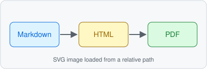
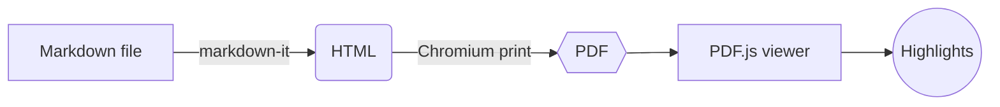
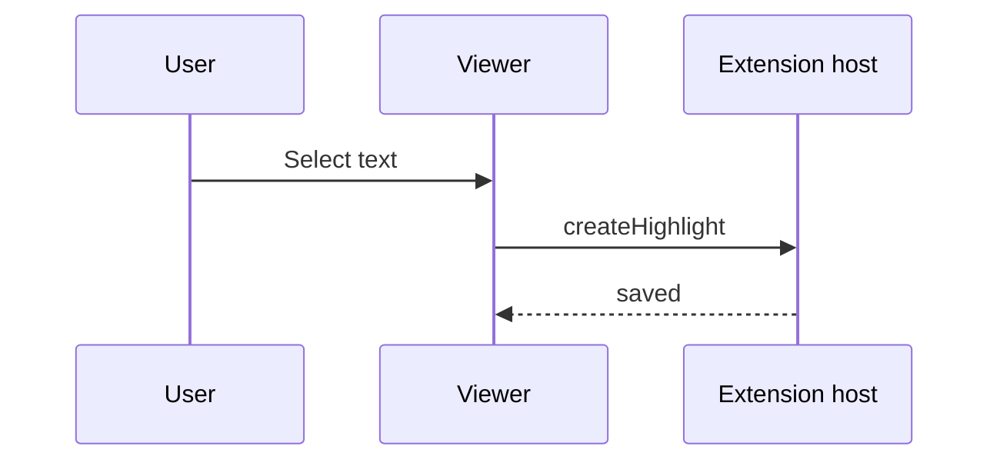

# Markdown PDF Viewer — Feature Test

This document exercises every Markdown feature the converter supports. Open it with
**Markdown PDF: Open PDF Preview to the Side** and compare each section with its description.
The front matter at the top of the file (title, author, tags) must **not** appear in the PDF.

**Contents:** [Text](#text-formatting) · [Links](#links) · [Lists](#lists) · [Tables](#tables) ·
[Images](#images) · [Code](#code-blocks) · [Math](#math) · [Diagrams](#diagrams) ·
[Quotes and alerts](#blockquotes-and-alerts) · [HTML](#inline-html) · [Footnotes](#footnotes) ·
[Page breaks](#page-breaks) · [Back to top](#markdown-pdf-viewer--feature-test)

## Text formatting

Plain paragraph text with *emphasis*, **strong emphasis**, ***both***, ~~strikethrough~~,
`inline code`, and a hard line break at the end of this line\
which continues here. Portuguese text keeps its accents: ação, coração, pão, você, avô.
Other scripts fall back to system fonts: 日本語のテキスト, Ελληνικά, Русский текст.

Emoji shortcodes :smile: :rocket: :tada: :+1: :warning: and literal emoji 🎉 ✅ 🚀 render in color.

### Heading level 3

#### Heading level 4

##### Heading level 5

###### Heading level 6

---

## Links

- External link: [VS Code website](https://code.visualstudio.com/) opens in the system browser.
- Autolink: <https://github.com/markdown-it/markdown-it> and a bare URL https://example.com/docs.
- E-mail: <mailto:someone@example.com>
- Internal anchor: jump to [the Math section](#math) or to [the second "Example" heading](#example-1).
- Relative link to another Markdown file: [other.md](other.md) and to a heading in it: [other.md → Intro](other.md#intro).
- Relative link with a folder: [fixtures/other.md](../fixtures/other.md).
- Link to a heading in this same file through its own name: [Tables (same file)](feature-test.md#tables).

### Example

The first "Example" heading has the anchor `#example`.

### Example

The second one gets `#example-1`, like on GitHub.

## Lists

1. First ordered item
2. Second ordered item
   1. Nested ordered item
   2. Another nested item
      - Third-level bullet
      - Another third-level bullet
3. Third ordered item with a paragraph.

   A second paragraph inside the same list item.

- Unordered item
  - Nested unordered item
    - Third level
      - Fourth level
- Mixed with `code` and a [link](#links)

### Task list

- [x] Write the converter
- [x] Render the PDF in a webview
- [ ] Highlight text in five colors
  - [x] Nested done task
  - [ ] Nested open task
- [ ] Download with highlights

## Tables

Column alignment comes from the delimiter row:

| Left aligned | Centered | Right aligned | Default |
|:-------------|:--------:|--------------:|---------|
| apples       | 🍎        | 1.50          | crisp   |
| bananas      | 🍌        | 0.25          | ripe    |
| cherries     | 🍒        | 12.00         | sweet   |
| **Total**    |          | **13.75**     |         |

A wide table with many columns is scaled down to fit the page instead of being cut off:

| ID | Name | E-mail | Department | Location | Start date | Salary band | Manager | Projects | Status | Notes |
|----|------|--------|------------|----------|------------|-------------|---------|----------|--------|-------|
| 1 | Ana Souza | ana.souza@example.com | Engineering | São Paulo | 2021-03-15 | B3 | Carlos Lima | Atlas, Borealis | Active | Leads the PDF export work |
| 2 | Bruno Alves | bruno.alves@example.com | Design | Porto Alegre | 2022-07-01 | B2 | Daniela Rocha | Borealis | Active | Owns the viewer toolbar |
| 3 | Carla Dias | carla.dias@example.com | Research | Lisbon | 2019-11-20 | C1 | Eduardo Nunes | Cirrus, Atlas, Dynamo | On leave | Back in March |

A long table repeats its header row on every page:

| # | Item | Quantity | Unit price | Subtotal |
|--:|------|---------:|-----------:|---------:|
| 1 | Notebook | 3 | 12.90 | 38.70 |
| 2 | Pencil | 12 | 1.20 | 14.40 |
| 3 | Eraser | 5 | 0.80 | 4.00 |
| 4 | Ruler | 2 | 3.50 | 7.00 |
| 5 | Stapler | 1 | 18.00 | 18.00 |
| 6 | Paper clips | 100 | 0.02 | 2.00 |
| 7 | Folder | 10 | 2.30 | 23.00 |
| 8 | Marker | 6 | 4.10 | 24.60 |
| 9 | Highlighter | 5 | 3.70 | 18.50 |
| 10 | Sticky notes | 8 | 2.90 | 23.20 |
| 11 | Scissors | 2 | 9.90 | 19.80 |
| 12 | Glue stick | 4 | 2.50 | 10.00 |
| 13 | Tape | 3 | 3.10 | 9.30 |
| 14 | Calculator | 1 | 49.00 | 49.00 |
| 15 | Envelope | 50 | 0.15 | 7.50 |
| 16 | Binder | 4 | 6.40 | 25.60 |
| 17 | Index cards | 200 | 0.03 | 6.00 |
| 18 | Whiteboard pen | 4 | 5.20 | 20.80 |
| 19 | Desk lamp | 1 | 89.90 | 89.90 |
| 20 | Mouse pad | 2 | 11.00 | 22.00 |

## Images

A relative PNG next to the Markdown file:


A relative SVG:



A workspace-root path (VS Code treats `/` as the workspace folder):


A remote SVG badge and a remote PNG (embedded at conversion time):

 

A raw HTML image with a width, centered:

<p align="center"></p>

A very tall image is scaled to fit on one page:


A deliberately missing image shows a placeholder and a warning:


## Code blocks

```typescript
// TypeScript: syntax highlighting comes from VS Code's own grammars (Shiki).
interface Highlight {
  id: string;
  color: 'yellow' | 'pink' | 'green' | 'blue' | 'orange';
  quote: string;
}

export function describe(h: Highlight): string {
  return `${h.color}: “${h.quote}”`;
}
```

```python
from dataclasses import dataclass

@dataclass
class Page:
    number: int
    text: str

    def words(self) -> list[str]:
        """Split the page text into words."""
        return [w for w in self.text.split() if w]
```

```json
{
  "markdownPdfViewer.pageSize": "A4",
  "markdownPdfViewer.pageNumbers": true,
  "nested": { "array": [1, 2.5, null, false] }
}
```

```bash
# Shell commands
npm install && npm run build
code --install-extension markdown-pdf-viewer-0.1.0.vsix --force
```

```diff
- removed line
+ added line
  unchanged line
```

A very long line wraps instead of being cut off, because a PDF cannot scroll horizontally:

```js
const veryLongLine = "Lorem ipsum dolor sit amet, consectetur adipiscing elit, sed do eiusmod tempor incididunt ut labore et dolore magna aliqua. Ut enim ad minim veniam, quis nostrud exercitation ullamco laboris.";
```

```
Plain text block without a language.
    Indentation is preserved.
```

    Indented code block (four spaces).

## Math

Inline math: the mass–energy relation $E = mc^2$ and the quadratic formula
$x = \frac{-b \pm \sqrt{b^2 - 4ac}}{2a}$ sit inside the text.

Display math:

$$
\int_{-\infty}^{\infty} e^{-x^2}\,dx = \sqrt{\pi}
\qquad
\sum_{n=1}^{\infty} \frac{1}{n^2} = \frac{\pi^2}{6}
$$

A bare `\begin{align}` block:

\begin{align}
a &= b + c \\
d &= e \cdot f
\end{align}

A fenced math block:

```math
\mathbf{A} = \begin{pmatrix} 1 & 2 \\ 3 & 4 \end{pmatrix}, \quad \det \mathbf{A} = -2
```

## Diagrams

A Mermaid flowchart:



A Mermaid sequence diagram:



## Blockquotes and alerts

> A blockquote with **formatting** and a [link](#links).
>
> > A nested blockquote.

> [!NOTE]
> Useful information that users should know, even when skimming content.

> [!TIP]
> Helpful advice for doing things better or more easily.

> [!IMPORTANT]
> Key information users need to know to achieve their goal.

> [!WARNING]
> Urgent info that needs immediate user attention to avoid problems.

> [!CAUTION]
> Advises about risks or negative outcomes of certain actions.

## Inline HTML

Press <kbd>Ctrl</kbd>+<kbd>K</kbd> <kbd>Shift</kbd>+<kbd>P</kbd> to open the preview.
Water is H<sub>2</sub>O, and x<sup>2</sup> is a square. Some <mark>marked text</mark> and an
<abbr title="Portable Document Format">PDF</abbr> abbreviation.

<details open>
<summary>A details block (shown open in the PDF)</summary>

Content inside `<details>` with **Markdown** formatting.

</details>

<div align="center"><em>A centered HTML block.</em></div>

<script>document.body.innerHTML = '<h1>SCRIPT RAN — this must never appear</h1>';</script>

## Footnotes

Footnotes link to the bottom of the document[^1] and back. A second note uses a name[^note].

[^1]: The first footnote. Click the arrow to return to the text.
[^note]: A named footnote with `code` and a [link](https://example.com).

## Page breaks

Headings are kept with the paragraph that follows them, and short code blocks, images,
diagrams and table rows are never split across pages. The paragraphs below fill the page so
that the next heading lands near a page boundary.

Lorem ipsum dolor sit amet, consectetur adipiscing elit. Integer nec odio. Praesent libero.
Sed cursus ante dapibus diam. Sed nisi. Nulla quis sem at nibh elementum imperdiet. Duis
sagittis ipsum. Praesent mauris. Fusce nec tellus sed augue semper porta. Mauris massa.
Vestibulum lacinia arcu eget nulla. Class aptent taciti sociosqu ad litora torquent per
conubia nostra, per inceptos himenaeos.

Curabitur sodales ligula in libero. Sed dignissim lacinia nunc. Curabitur tortor. Pellentesque
nibh. Aenean quam. In scelerisque sem at dolor. Maecenas mattis. Sed convallis tristique sem.
Proin ut ligula vel nunc egestas porttitor. Morbi lectus risus, iaculis vel, suscipit quis,
luctus non, massa. Fusce ac turpis quis ligula lacinia aliquet.

Mauris ipsum. Nulla metus metus, ullamcorper vel, tincidunt sed, euismod in, nibh. Quisque
volutpat condimentum velit. Class aptent taciti sociosqu ad litora torquent per conubia nostra,
per inceptos himenaeos. Nam nec ante. Sed lacinia, urna non tincidunt mattis, tortor neque
adipiscing diam, a cursus ipsum ante quis turpis.

### The end

This is the last section. [Back to the top](#markdown-pdf-viewer--feature-test).
